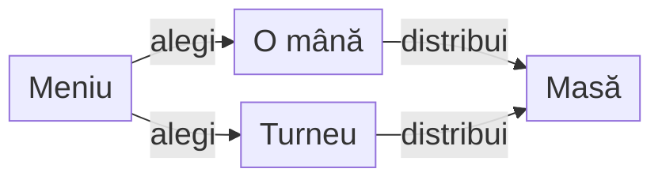

# ATF J6 · Hold’em Lab

## Pe scurt

Hold’em Lab este un joc No-Limit Texas Hold’em pentru Android. Poți juca offline o mână de antrenament sau un turneu împotriva AI-ului. Motorul definește regulile mesei, iar arena permite compararea strategiilor pe aceleași distribuiri.

## Jocul

- **[Hold'em Lab 0.17.0 — documentația release-ului](https://github.com/crististefanita/atf_j6/releases/tag/v0.17.0)**
- **[Descarcă APK-ul Hold'em Lab 0.17.0](https://github.com/crististefanita/atf_j6/releases/download/v0.17.0/HoldemLab-0.17.0.apk)**

## Prima mână după instalare

La prima pornire, meniul este în engleză. Poți selecta româna din **Language**. Alege un mod de joc și confirmă cu **Deal cards** sau **Împarte cărțile**.



<details>
<summary><strong>Legendă — modurile de joc</strong></summary>

- **Play a hand / Joacă o mână** oferă mese de 2, 4, 5 sau 6 locuri, cu blinduri fixe.
- **Play a tournament / Joacă un turneu** oferă 4–6 locuri, nivel Normal sau Hard și blinduri progresive cu interval configurabil.
- **Masa de joc** afișează cărțile proprii și opțiunile legale când îți vine rândul.

</details>

Pentru o sesiune existentă, folosește **Continue saved game / Continuă jocul salvat**. Din meniu poți deschide Realizările și clasamentul turneelor. [Ghidul Android](holdem-android/README.md) · [Verificarea fluxurilor Android](docs/testing/TEST_STRATEGY.md#interfața-android-locală)

## Module

| Modul | Contract |
|---|---|
| `holdem-core` | Cărți, străzi, observația actorului, acțiuni legale și decontarea poturilor; fără Android sau rețea. |
| `holdem-ai` | Politici de joc și estimare Monte Carlo reproductibilă, cu ponderi de context în YAML. |
| `holdem-arena` | Turnee cu blinduri progresive, mese cash cu blinduri fixe, seed-uri și replay. |
| `holdem-online` | Configurație inspectabilă în `dry-run`. Conectarea la o platformă externă este o etapă viitoare. |
| `holdem-app` | Consolă pentru o decizie locală și inspecția configurației online. |
| `holdem-android` | Joc local, salvare și reluare, Realizări și clasament de turnee. |

## Biblioteci comune

J6 consumă Core, Reporting, Console, Mock și Test Kit din perechile JAR/POM din [lib](lib/README.md). POM-ul rădăcină fixează versiunile și instalarea; testele verifică proveniența și integrarea.

[PlatformLibraryAdoptionTest](holdem-app/src/test/java/ro/atf/j6/libraries/PlatformLibraryAdoptionTest.java) verifică hash-urile binare, proveniența JSON, transportul mock și raportul Extent. Biblioteca comună este întreținută în J0; regulile Hold’em rămân în J6.

## Cerințe și documentație

- [Cerințe de produs, reguli de joc și evaluarea AI](docs/requirements/README.md)
- [Arhitectura motorului, simulării și aplicației](docs/architecture/ARCHITECTURE.md)
- [Proiectarea realizărilor într-un joc](docs/design/achievements/README.md)
- [Strategie de testare](docs/testing/TEST_STRATEGY.md)
- [Catalogul release-urilor](release/README.md)
- [Procesul de release Android](docs/release/ATF_Release.md)
- [RAG pentru impactul unei schimbări](docs/release/ATF_Release.md#contextul-rag-consultativ)
- [Feedback activ](docs/feedback/README.md)

## Construire locală

Pentru componente și guvernanță, folosește JDK 21 sau mai nou, Maven 3.9 sau mai nou, Git și PowerShell 7. Setează `HOLDEM_MAVEN_REPOSITORY` la repository-ul Maven extern și rulează comanda. Pentru build-ul aplicației ai nevoie și de Android SDK platform 36. [Calificarea Android](docs/release/ATF_Release.md#calificare-reproductibilă)

```powershell
mvn -B -ntp "-Dmaven.repo.local=$env:HOLDEM_MAVEN_REPOSITORY" test
```

Consola poate fi pornită din IDE după importul proiectului Maven. [Punctul de intrare](holdem-app/src/main/java/ro/atf/holdem/app/LocalAppMain.java)
