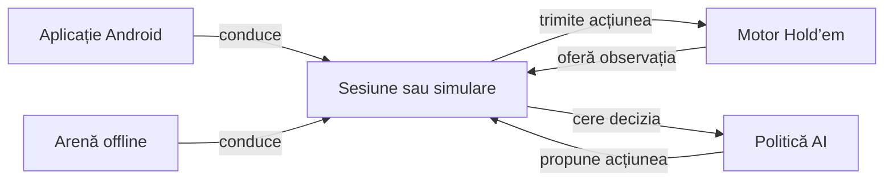
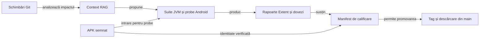

# ATF J6 · Hold’em Lab

## Pe scurt

Hold’em Lab este un joc offline de No-Limit Texas Hold’em pentru Android și un laborator pentru evaluarea strategiilor AI. Jocul și simulatorul folosesc aceleași reguli și aceeași interfață de decizie. Proiectul include testele și dovezile de calificare ale APK-ului.

## Jocul

- **[Hold’em Lab 0.19.1 — documentația release-ului](https://github.com/crististefanita/atf_j6/releases/tag/v0.19.1)**
- **[Descarcă APK-ul Hold’em Lab 0.19.1](https://github.com/crististefanita/atf_j6/releases/download/v0.19.1/HoldemLab-0.19.1.apk)**

## Arhitectură



<details>
<summary><strong>Legendă — de la observație la acțiune</strong></summary>

- Motorul păstrează starea completă, calculează mutările legale și decontează poturile.
- Politica vede cărțile actorului și informația publică. Sesiunea sau arena transmite propunerea, iar motorul îi verifică legalitatea.
- Android reconstruiește sesiunea din checkpoint. Arena păstrează distribuirea, configurația și acțiunile pentru replay și comparații reproductibile.

</details>

| Zonă | Responsabilitate |
|---|---|
| [holdem-core](holdem-core) | Reguli, stare, observația actorului, acțiuni legale și decontare. |
| [holdem-ai](holdem-ai) | Politici de decizie, estimarea equity și praguri configurabile. |
| [holdem-arena](holdem-arena) | Simulări de mese cash și turnee, evaluare pe distribuiri pereche și replay. |
| [holdem-app](holdem-app) | Punct de intrare în consolă și suitele de integrare, guvernanță și release. |
| [holdem-online](holdem-online) | Configurație și inspecție în modul `dry-run`. |
| [holdem-android](holdem-android/README.md) | Aplicația offline, sesiunea locală, Realizările și clasamentul. |

Maven construiește cele cinci module JVM. Gradle construiește aplicația `:app` și modulul `:engine`, care compilează aceleași surse din `holdem-core` și `holdem-ai` cu țintă Java 17. Aplicația folosește biblioteca Card Table pentru elementele comune de interfață.

| Director | Ce găsești aici |
|---|---|
| [config](config) | Reguli și profiluri în YAML, catalogul Realizărilor și inventarul suitelor. |
| [lib](lib/README.md) | Core, Reporting, Console, Mock și Test Kit, fixate ca perechi JAR/POM. |
| [scripts](scripts) | Rulare, simulare, audit, calificare și verificarea distribuției. |
| [docs](docs) | Contractele produsului, arhitectura, strategia de testare și feedback-ul activ. |
| [release](release) | Dosarele edițiilor, manifestele și rapoartele de calificare. |

## Testare și livrare



<details>
<summary><strong>Legendă — de la schimbare la distribuție</strong></summary>

- RAG leagă diff-ul de contractele și suitele afectate. Rezultatele provin din execuție.
- Maven și Android JVM verifică regulile și componentele. Probele native verifică interacțiunea și afișarea pe un APK identificat.
- Promovarea compară binarul și dovezile calificării. Verificarea distribuției confruntă tagul, README-ul remote și APK-ul descărcat.

</details>

### Verificare locală

Într-un checkout de lucru, rulează suitele JVM cu JDK 21 sau mai nou și Maven 3.9 sau mai nou. Configurează `HOLDEM_MAVEN_REPOSITORY` pentru cache-ul Maven extern. Pentru build-ul Android este necesar și SDK Platform 36.

```powershell
mvn -B -ntp "-Dmaven.repo.local=$env:HOLDEM_MAVEN_REPOSITORY" test
```

Inventarul fixează nivelul suitelor JVM și al testelor Android. Calificarea distinge testele de componentă de instrumentarea nativă și leagă dovezile de APK-ul verificat. [Inventarul suitelor](config/release-test-suites.json)

## Cerințe și documentație

- [Cerințe de produs, reguli de joc și evaluarea AI](docs/requirements/README.md)
- [Arhitectura motorului, simulării și aplicației](docs/architecture/ARCHITECTURE.md)
- [Ghidul aplicației Android](holdem-android/README.md)
- [Proiectarea realizărilor într-un joc](docs/design/achievements/README.md)
- [Strategie de testare](docs/testing/TEST_STRATEGY.md)
- [Guvernanță locală](docs/governance/README.md)
- [Catalogul release-urilor](release/README.md)
- [Procesul de release Android](docs/release/ATF_Release.md)
- [RAG pentru impact și deploy](docs/release/ATF_Release.md#planul-rag-pentru-deploy-pe-ramura-principală)
- [Feedback activ](docs/feedback/README.md)
