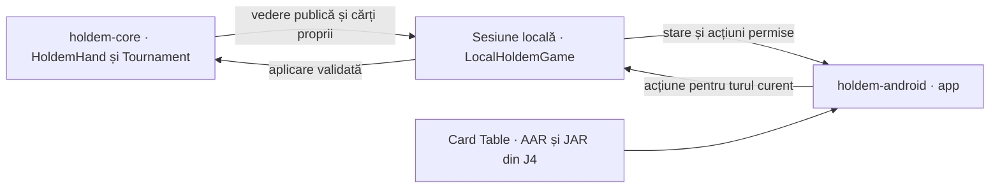
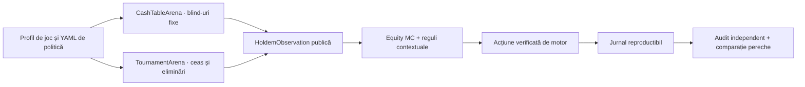

# Arhitectură J6

```text
                 +----------------------+
                 |      holdem-app      |
                 | CLI / operator       |
                 +----------+-----------+
                            |
              +-------------+--------------+
              |                            |
       +------v------+              +------v------+
       | holdem-arena |              | holdem-online|
       | cash + MTT   |              | WS adapter   |
       +------+-------+              +------+-------+
              |                             |
              +-------------+---------------+
                            |
                    +-------v--------+
                    |   holdem-ai    |
                    | policies/equity|
                    +-------+--------+
                            |
                    +-------v--------+
                    |  holdem-core   |
                    | rules/state    |
                    +----------------+
```

## Limite de dependențe

- `holdem-core` nu depinde de AI, rețea sau UI;
- `holdem-ai` consumă `Observation`, nu `FullState`;
- `holdem-arena` poate folosi starea completă intern pentru simulare, dar filtrează observația înainte de policy;
- `holdem-online` convertește wire messages în `Observation` și `ActionRequest`;
- `holdem-app` orchestrează, dar nu introduce reguli de poker.

## Interfața Android locală



Gradle compilează sursele `holdem-core` pentru Java 17. Motorul expune o vedere imutabilă pentru un loc fix. Sesiunea leagă fiecare comandă umană de identitatea mâinii și revizia turului, apoi trece prin același validator și pentru răspunsurile adversarilor. În turneu, `Tournament` păstrează stivele și alege următorul dealer dintre locurile cu jetoane. Sesiunea Android stabilește când parcursul uman se încheie și reface rundele din seed și comenzile acceptate. UI rotește locurile în jurul jucătorului propriu și prezintă plata mâinii înainte de ecranul final. [Integrarea și frontiera bibliotecii](../../holdem-android/README.md)

## Reducer și replay

Motorul trebuie modelat ca reducer:

```text
FullState + Action -> Transition(FullState, PublicEvent, SettlementDelta)
```

Orice eveniment trebuie să poată fi serializat, verificat și aplicat din nou. Pentru online, reducerul local nu înlocuiește snapshot-ul autoritar al serverului; îl folosește ca verificare și fallback.

## Configurare

Regulile de joc, bugetul AI, profilele de adversari și transportul se configurează declarativ. Configurația nu poate schimba invarianta fundamentală că politica nu primește cărți adverse reale.

## Două sesiuni offline



`CashTableArena` reține stivele între mâini, nu mărește blind-urile și oprește sesiunea la limita de mâini ori când rămâne un singur loc finanțat. `TournamentArena` folosește nivelurile YAML și oprește după victoria unui singur jucător. Ambele folosesc același motor de mână și portul `DecisionPolicy`; diferența de structură nu se amestecă în politica AI.

Politicile văd numai observația actorului. Monte Carlo elimină cărțile proprii și board-ul cunoscut, apoi eșantionează adversarii rămași și board-ul necunoscut. Acțiunile publice nu sunt folosite ca să reconstruiască o mână ascunsă; ele schimbă numai ponderile configurate pentru agresiune, numărul adversarilor și poziție. [Cerințele și limitele estimării](../requirements/AI_REQUIREMENTS.md)
