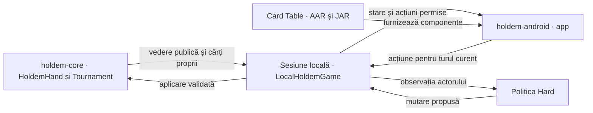
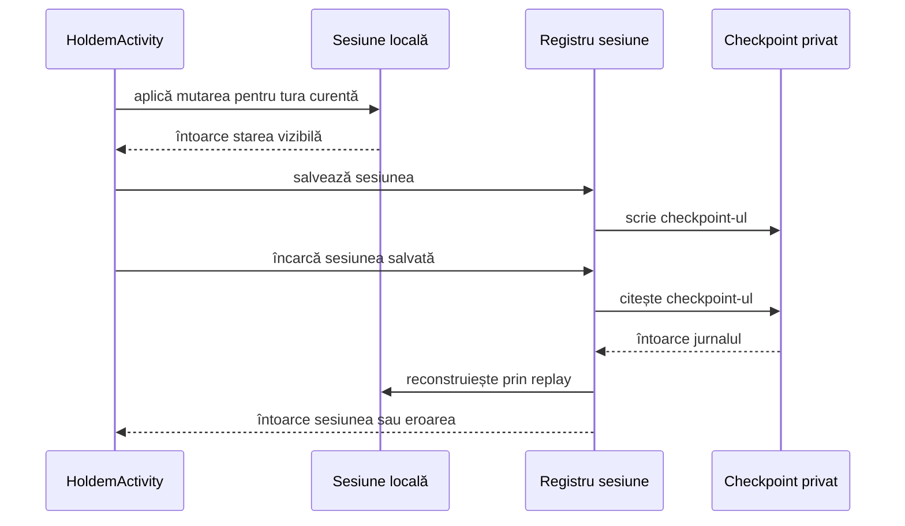
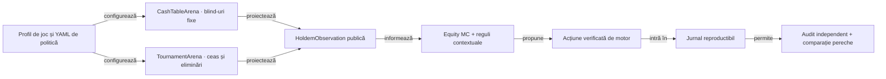

# Arhitectură J6

## Pe scurt

Motorul Hold’em deține regulile și legalitatea. Politicile decid din observația actorului, arena execută simulările offline, iar Android gestionează sesiunea interactivă.

```text
Dependențe directe Maven
holdem-app    → holdem-core, holdem-ai, holdem-online
holdem-arena  → holdem-core, holdem-ai
holdem-ai     → holdem-core
holdem-online → holdem-core
```

Consola pornește o decizie locală și poate inspecta configurația online. Arena are propriile puncte de intrare pentru cash și turnee. [Consola](../../holdem-app/src/main/java/ro/atf/holdem/app/LocalAppMain.java) · [Mese cash](../../holdem-arena/src/main/java/ro/atf/holdem/arena/CashTableArena.java) · [Turnee](../../holdem-arena/src/main/java/ro/atf/holdem/arena/TournamentArena.java)

## Granița dintre produs și verificare

Gradle include `:app` și `:engine`. `:engine` compilează sursele motorului și AI-ului, iar `:app` consumă motorul și componentele Card Table fixate în depozitul Android din proiect. [Configurația motorului Gradle](../../holdem-android/engine/build.gradle) · [Dependențele aplicației](../../holdem-android/app/build.gradle)

Perechile ATF din `lib` susțin verificarea Maven și publicarea dovezilor. Inventarul suitelor acoperă Maven și Android JVM, iar instrumentarea verifică scenarii pe un APK identificat. Procesul de release verifică rezultatele înainte de promovare. [Adopția bibliotecilor](../../lib/README.md) · [Strategia de testare](../testing/TEST_STRATEGY.md) · [Procesul de release](../release/ATF_Release.md)

## Limite de dependențe

- `holdem-core` deține regulile, acțiunile legale și decontarea.
- `holdem-ai` primește `HoldemObservation` prin portul `DecisionPolicy`. Observația conține cărțile actorului și informația publică.
- `holdem-arena` conduce simularea și transmite politicii proiecția motorului pentru actorul curent.
- `holdem-online` descrie endpointul, prezența credențialului și modul `dry-run`. Conexiunea și adaptarea mesajelor apar în cerințele unei etape viitoare.
- `holdem-app` orchestrează exemplul de consolă prin API-ul motorului.

## Interfața Android locală



<details>
<summary><strong>Legendă — sesiunea Android</strong></summary>

- **Motor** validează mutarea și avansează starea.
- **Sesiune** leagă comanda de mână, tură și revizie.
- **Interfață** prezintă actorul, cărțile vizibile și premiile de la decontare.

</details>

- Gradle compilează sursele comune ale motorului și politicii pentru Java 17.
- `HoldemActivity` cere propunerile adversarilor Hard prin `HoldemTableTasks` și verifică din nou scena și tura înainte de aplicare.
- La suspendare, Activity oprește ceasul și salvează checkpoint-ul. La restaurare, sesiunea verifică actorul și legalitatea mutărilor. [Integrarea Android](../../holdem-android/README.md)

| Componentă Android | Responsabilitate |
|---|---|
| `HoldemActivity` | Conectează navigarea, lifecycle-ul, sesiunea și persistența. Aplică o propunere numai pentru scena și tura curente. |
| `HoldemTableTasks` | Execută recomandări, mutări automate și estimări în fundal. Identifică lucrarea curentă și livrează rezultatul prin executorul UI. |
| `HoldemAchievementNotice` | Prezintă progresul confirmat de persistență prin dialogul Card Table UI. |
| `HoldemTableView` și `HoldemTablePresentation` | Compun masa și proiectează informația vizibilă. |
| `BettingLedgerView` și `TableViewportPosition` | Afișează jurnalul și păstrează poziția și focusul la redesenarea aceleiași mâini. |
| `SettlementAwardAnimator` | Afișează premiile temporare în overlay și gestionează finalizarea sau anularea animației. |

### Cum se salvează și se reia o mână

Aplicația salvează mutările acceptate, apoi le reexecută prin motor la reluare.



<details>
<summary><strong>Legendă — salvare și reluare</strong></summary>

- **Sesiunea locală** leagă mutarea de revizia turei și aplică regulile motorului.
- **Registrul sesiunii** este `HoldemSessionRepository`. El citește și scrie checkpoint-ul prin adaptorul de stocare.
- **Checkpoint-ul** păstrează actorii, mutările și dificultatea. Sesiunile mai vechi se deschid în Normal.
- **Restaurarea** revalidează mutările înainte să afișeze masa.

</details>

## Acțiuni legale și replay

- `HoldemHand.observeActor()` proiectează starea mâinii pentru politică. La `HoldemHand.act()`, motorul verifică din nou actorul și suma. [Motorul mâinii](../../holdem-core/src/main/java/ro/atf/holdem/core/HoldemHand.java)
- Replay-ul reface distribuirea și aplică mutările în ordine. [Testele reluării](../../holdem-android/app/src/test/java/ro/atf/holdem/android/HoldemSessionRepositoryComponentTest.java)
- O integrare online viitoare va trebui să reconcilieze starea locală cu răspunsul autoritar al serverului. [Cerințe online](../requirements/ONLINE_REQUIREMENTS.md)

## Configurare

Arena citește din YAML regulile, bugetul AI și profilurile. Android compilează profilul în aplicație, iar un test confruntă parametrii de presiune Hard cu valorile din YAML. Politica primește numai informația permisă actorului.

## Două sesiuni offline



<details>
<summary><strong>Legendă — simulare și audit</strong></summary>

- **Configurația** fixează regulile, lineup-ul și parametrii.
- **Observația** expune numai informația permisă actorului.
- **Jurnalul** permite verificarea separată a simulării și decontării.

</details>

`CashTableArena` reține stivele între mâini, nu mărește blind-urile și oprește sesiunea la limita de mâini ori când rămâne un singur loc finanțat. `TournamentArena` folosește nivelurile YAML și oprește după victoria unui singur jucător. Ambele folosesc același motor de mână și portul `DecisionPolicy`; diferența de structură nu se amestecă în politica AI.

Estimatorul Monte Carlo folosit de politica de bază exclude cărțile proprii și board-ul cunoscut, apoi eșantionează uniform distribuțiile rămase. Istoricul public poate ajusta pragurile deciziei. Arena poate evalua separat candidați cu range-uri de răspuns condiționate de ofertă și reacție. [Cerințele și limitele estimării](../requirements/AI_REQUIREMENTS.md#equity-contra-range-ului-care-răspunde)
