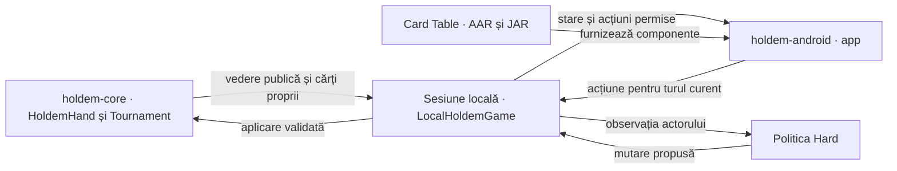
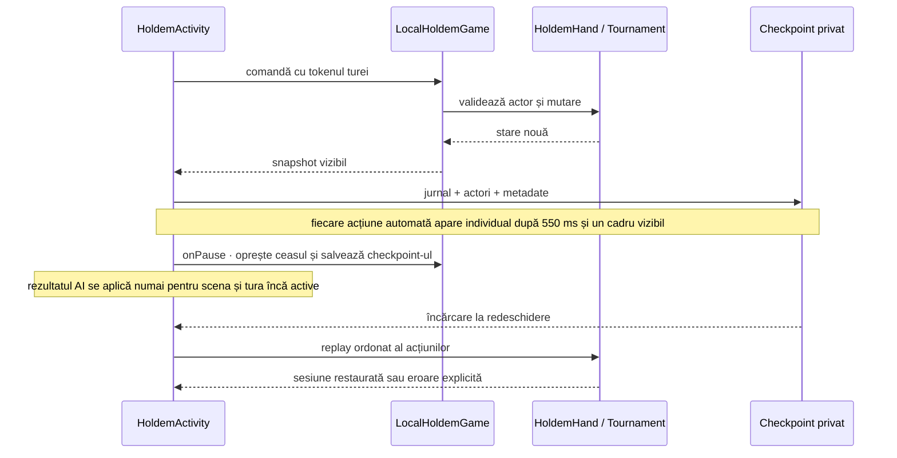
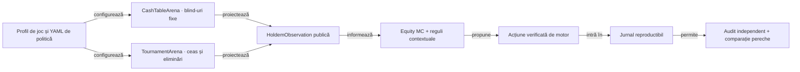

# Arhitectură J6

## Pe scurt

Motorul Hold’em deține regulile și legalitatea. Politicile decid din observația actorului, arena execută simulările offline, iar Android gestionează sesiunea interactivă.

```text
Dependențe directe Maven
holdem-app    → holdem-core, holdem-ai, holdem-online
holdem-arena  → holdem-core, holdem-ai
holdem-ai     → holdem-core
holdem-online → holdem-core
```

Consola pornește o decizie locală și poate inspecta configurația online. Arena are propriile puncte de intrare pentru cash și turnee.

## Limite de dependențe

- `holdem-core` nu depinde de AI, rețea sau UI;
- `holdem-ai` consumă `Observation`, nu `FullState`;
- `holdem-arena` poate folosi starea completă intern pentru simulare, dar filtrează observația înainte de policy;
- `holdem-online` descrie endpointul, prezența credentialului și modul `dry-run`. Conexiunea și adaptarea mesajelor sunt contracte pentru o etapă viitoare.
- `holdem-app` orchestrează, dar nu introduce reguli de poker.

## Interfața Android locală



<details>
<summary><strong>Legendă — sesiunea Android</strong></summary>

- **Motor** validează mutarea și avansează starea.
- **Sesiune** leagă comanda de mână, tură și revizie.
- **Interfață** prezintă actorul, cărțile vizibile și premiile de la decontare.

</details>

- Gradle compilează sursele comune ale motorului și politicii pentru Java 17.
- Activity calculează în fundal propunerile adversarilor Hard și verifică din nou scena și tura înainte de aplicare.
- La suspendare, Activity oprește ceasul și salvează checkpoint-ul. La restaurare, sesiunea verifică actorul și legalitatea mutărilor. [Integrarea Android](../../holdem-android/README.md)



<details>
<summary><strong>Legendă — salvare și reluare</strong></summary>

- **Tokenul turei** identifică mutarea pentru revizia acceptată.
- **Checkpoint-ul** păstrează actorii, mutările și dificultatea. Sesiunile mai vechi se deschid în Normal.
- **Restaurarea** revalidează mutările înainte să afișeze masa.

</details>

## Reducer și replay

Motorul trebuie modelat ca reducer:

```text
FullState + Action -> Transition(FullState, PublicEvent, SettlementDelta)
```

Orice eveniment trebuie să poată fi serializat, verificat și aplicat din nou. Pentru online, reducerul local nu înlocuiește snapshot-ul autoritar al serverului; îl folosește ca verificare și fallback.

## Configurare

Arena citește din YAML regulile, bugetul AI și profilurile. Android compilează profilul în aplicație, iar un test confruntă parametrii de presiune Hard cu valorile din YAML. Politica primește numai informația permisă actorului.

## Două sesiuni offline



<details>
<summary><strong>Legendă — simulare și audit</strong></summary>

- **Configurația** fixează regulile, lineup-ul și parametrii.
- **Observația** expune numai informația permisă actorului.
- **Jurnalul** permite verificarea separată a simulării și decontării.

</details>

`CashTableArena` reține stivele între mâini, nu mărește blind-urile și oprește sesiunea la limita de mâini ori când rămâne un singur loc finanțat. `TournamentArena` folosește nivelurile YAML și oprește după victoria unui singur jucător. Ambele folosesc același motor de mână și portul `DecisionPolicy`; diferența de structură nu se amestecă în politica AI.

Politicile văd numai observația actorului. Monte Carlo elimină cărțile proprii și board-ul cunoscut, apoi eșantionează adversarii rămași și board-ul necunoscut. Acțiunile publice nu sunt folosite ca să reconstruiască o mână ascunsă; ele schimbă numai ponderile configurate pentru agresiune, numărul adversarilor și poziție. [Cerințele și limitele estimării](../requirements/AI_REQUIREMENTS.md)
