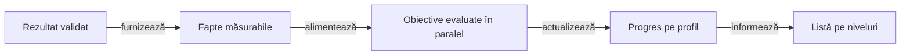

# Proiectarea realizărilor într-un joc

## Pe scurt

Realizările marchează ce a reușit jucătorul într-o partidă. Ghidul definește cum alegem obiectivele, cum le legăm de rezultatele motorului și cum verificăm progresul înainte de lansare. [Aplicarea în Hold’em](../../requirements/PRODUCT_REQUIREMENTS.md#realizări) arată ce este specific jocului.



<details>
<summary><strong>Legendă — de la rezultatul partidei la progres</strong></summary>

- **Fapt** este o informație verificată, cum ar fi câștigătorul unei runde.
- **Obiectiv** folosește faptul pentru a acorda credit conform unui criteriu.
- **Profil** păstrează progresul confirmat la reluare.

</details>

## Pornește de la joc

1. Enumeră situațiile în care jucătorul ia decizii și rezultatele care arată că a înțeles mecanica. Separă rezultatul unei runde, al unei partide și al unei competiții.
2. Alege pentru fiecare nivel un prim obiectiv ușor de explicat. La Ușoare, jucătorul obține primul rezultat de bază. La Medii, duce la capăt un obiectiv complet. La Grele, repetă o performanță în partide distincte sau reușește într-o situație rară și precis definită.
3. Grupează câte 5–6 obiective în jurul unei competențe. Ordinea recomandă ce să încerce jucătorul. În grup, fiecare obiectiv poate progresa în orice ordine. Folosește prerechizite doar când un mod de joc sau un eveniment chiar nu poate exista înaintea altuia.
4. Scrie criteriul înainte să alegi un prag: ce rezultat contează, în ce mod, pentru cine, când se confirmă și ce pare asemănător dar nu se califică.
5. Crește catalogul numai când apare o mecanică, o alegere sau o performanță distinctă. Mai multe praguri pe același contor sunt utile când marchează etape reale. Leagă progresul de evenimente observabile în joc.

| Nivel | Întrebarea de proiectare | Verificare |
|---|---|---|
| Ușor | Ce poate reuși jucătorul în primele sesiuni? | Motorul confirmă un rezultat accesibil într-un mod obișnuit. |
| Mediu | Ce rezultat cere coordonarea mai multor decizii? | O rundă sau o competiție se încheie cu rezultatul cerut. |
| Greu | Ce performanță este rară sau cere consecvență? | Se verifică situația exactă sau mai multe rezultate distincte. |

## Contractul progresului

| Componentă | Responsabilitate |
|---|---|
| Motorul | Confirmă rezultatul și emite identitatea participantului, a rundei sau a partidei. |
| Adaptorul jocului | Extrage fapte din rezultatul confirmat: câștig, clasare, regulă de departajare ori contextul unei acțiuni. |
| Catalogul | Asociază faptele cu un ID stabil, nivel, grup, ordine, prag și text localizat. |
| Stocarea | Separă profilurile și deduplică în fiecare obiectiv după cheia evenimentului. Salvează împreună actualizările produse de același eveniment. |
| Interfața | `card-table-ui` afișează lista, detaliul și panoul de progres. Adaptorul jocului transmite rânduri cu chei stabile, textele localizate și modificările confirmate. |

- Un rezultat poate satisface mai multe obiective. O victorie poate avansa simultan primul câștig și obiectivul cu trei câștiguri.
- Redeschiderea aceluiași rezultat nu avansează din nou niciun obiectiv. Separă identitatea contului de numele afișat.
- La schimbarea criteriului, păstrează sensul ID-ului existent sau introdu un ID nou cu o regulă de migrare explicită.

Pentru reguli tactice, verifică acțiunea în contextul disponibil înainte de decizie. Un rezultat norocos nu dovedește că decizia a fost bună. Pentru un obiectiv bazat pe rezultatul partidei, folosește verdictul final al motorului.

Păstrează această distincție vizibilă și în catalog: o realizare de rezultat descrie ce s-a întâmplat, iar una de competență poate cere și dovada deciziei. De exemplu, „a câștigat cu cea mai slabă combinație” poate fi un reper rar dacă motorul confirmă singur potul și contextul; textul nu trebuie să sugereze că jucătorul ar trebui să plătească mai des cu mâini slabe. Exclude egalitățile și modurile neeligibile când criteriul cere un câștigător unic sau o dificultate anume.

<details>
<summary>Model de catalog YAML pentru un proiect nou</summary>

Un catalog mic poate rămâne un tabel tipizat în cod. Dacă regulile sunt editate separat, validează la încărcare câmpurile și leagă fiecare metrică de un evaluator înregistrat. Exemplul descrie o schemă generică. Hold’em folosește un catalog YAML în subsetul JSON, din care Gradle generează catalogul Android. [Catalogul Hold’em](../../../config/j6-achievements.yaml)

```yaml
schemaVersion: 1
groups:
  - id: first-wins
    achievements:
      - id: first-round-win
        tier: easy
        order: 10
        metric: round.won
        distinctBy: roundId
        target: 1
        labelKey: achievement.firstRoundWin
      - id: three-round-wins
        tier: easy
        order: 20
        metric: round.won
        distinctBy: roundId
        target: 3
        labelKey: achievement.threeRoundWins
```

Respinge ID-urile duplicate, metricile necunoscute, pragurile invalide și textele lipsă. Catalogul descrie criteriile; evaluatorii rămân acoperiți de teste de domeniu.

</details>

## Cum adaugi o realizare în YAML

1. Alege evenimentul autoritar. Un showdown și un pariu acceptat sunt fapte diferite. O carte comună afișată automat poate exista fără o decizie pe runda respectivă.
2. Alege cheia distinctă potrivită. O realizare de mână primește credit o singură dată, chiar dacă jucătorul câștigă mai multe poturi în aceeași mână.
3. Scrie criteriul în ambele limbi și folosește pragul configurat în text. Păstrează ID-ul când schimbi ordinea sau traducerea.
4. Verifică rezultatul apropiat care trebuie respins. Pentru o acțiune pe două runde, două pariuri pe același flop formează o singură rundă.
5. Estimează dificultatea din progresul pe sesiuni și oportunități. Rulează confirmarea pe distribuții distincte de cele folosite la reglaj.

Pentru progres acumulat, separă lotul care estimează frecvența de lotul holdout care validează pragurile. Simulează sesiuni la bugetul apropiat de produs, numără sesiunile neterminate în numitor și nu combina automat date de auto-play cu rezultate manuale. Dacă simulatorul nu modelează istoricul persistent al profilului, marchează obiectivul ca necalificat de acel lot în loc să deduci că este imposibil.

Pentru Hold’em, familiile ordonează învățarea în interiorul nivelului. Completează criteriul cu proveniența manuală a mâinii sau a turneului, conform unității declarate. [Catalogul candidat](../../../config/j6-achievement-expansion.yaml) · [Strategia de replay](../../testing/TEST_STRATEGY.md#replay-pentru-catalogul-extins)

## Acceptanță înainte de lansare

- Pentru fiecare familie, testează un rezultat pozitiv și o situație asemănătoare fără credit. La praguri repetate, verifică valorile imediat sub și la prag.
- Reia același rezultat după restart. Verifică un profil diferit cu același nume și un rezultat identic ca scor, dar cu alt ID.
- Livrează două rezultate valide în ordine inversă. Confirmă că ambele realizări pot avansa și că ordinea din listă rămâne aceeași.
- Verifică o întrerupere între închiderea partidei și scrierea progresului. La reluare, rezultatul valid trebuie procesat o singură dată.
- În UI, verifică un profil nou, progres parțial și realizare obținută. Pentru calibrare, urmărește cât durează obiectivele, cât de des apar și ce comportament încurajează. Nu crește volumul doar pentru a umple un nivel.

[Strategia de testare](../../testing/TEST_STRATEGY.md) · [Cerințe de produs](../../requirements/PRODUCT_REQUIREMENTS.md)
