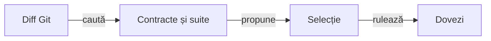

# Release Android Hold’em Lab

## Stări

| Stare | Criteriu |
|---|---|
| `DRAFT` | Versiune, note și guvernanță inspectabile; fără APK și fără link de descărcare. |
| `PREPARED` | Sursă fixată, APK semnat calificat conform profilului declarat, inventar SHA-256 și descărcare autentificată verificată. |
| `PUBLISHED` | Tag-ul indică commit-ul calificat, APK-ul și checksum-ul sunt atașate și ambele descărcări anonime sunt verificate. |

APK-urile intermediare, build-urile, cache-urile, logurile și capturile brute rămân sub rădăcina externă `HOLDEM_DATA_ROOT`. Dosarul ediției leagă pachetul selectat, checksum-ul, manifestul și rapoartele Extent cu imagini încorporate. APK-ul și checksum-ul se atașează la release.

## README principal și catalog

| Loc | Contract |
|---|---|
| `## Jocul` în `DRAFT` | O singură legătură, către dosarul ediției. |
| `## Jocul` după calificare | Exact două legături pentru `currentVersion`: pagina Release și APK-ul direct, în această ordine. |
| Dosarul ediției | Identitate, SHA-256, checksum, calificare, rapoarte și receipt-uri de distribuție. |
| Catalog și proces | Navigare tehnică din secțiunea de documentație a README-ului principal. |

- Guvernanța respinge rutele pentru altă versiune și textul suplimentar în blocul `Jocul`. Starea, dimensiunea și cerințele de autentificare se explică în dosarul ediției.
- Pentru `PREPARED`, păstrați dovada descărcării complete autentificate. Pentru `PUBLISHED`, adăugați dovada separată a descărcării anonime.
- Includeți `## Pe scurt` în README-ul ediției și în indexul rapoartelor înainte de calcularea hash-urilor. Păstrați fișierele deja inventariate la octet și documentați clarificările generale în acest ghid.

[Catalogul edițiilor](../../release/README.md)

### Audit editorial și dosare de ediție

| Domeniu | Ce intră | Cum tratăm constatările |
|---|---|---|
| Documentație activă | README-urile proiectului și modulelor, ghidurile, catalogul și documentele edițiilor aflate în pregătire. | Guvernanța locală trebuie să treacă înainte de calificare. |
| Dovezi de ediție | Fișierele din dosarul `PREPARED` sau `PUBLISHED` inventariate individual în `release-validation.json`. Regula se aplică și dosarului ediției curente. | Păstrați fișierele la octet. Separați numai observațiile editoriale existente enumerate în catalog, după verificarea căii, lungimii și SHA-256. |

Rulați guvernanța documentară din checkout și păstrați comparațiile Extent. Raportați separat constatările active și observațiile editoriale consemnate în dosarele sigilate. [Guvernanța locală](../governance/README.md)

- O observație nouă sau un link rupt blochează acceptanța documentului afectat. Un fișier lipsă ori o abatere de integritate blochează folosirea dovezii respective și se raportează separat.
- Pentru o ediție nouă, verificați titlul, secțiunea `Pe scurt`, proza și legăturile din README-ul ediției și din indexul rapoartelor înainte de inventariere.
- Clarificările de proces se fac în documentația activă. Starea, hash-urile, rapoartele și legăturile dintre dovezile ediției rămân în dosarul ei.

[Catalogul și lista observațiilor păstrate](../../release/README.md#versiuni)

## Contextul RAG consultativ

Runnerul compară candidatul cu ediția precedentă și propune ce să verifici. `CONTEXT_READY` indică un context cu surse și suite sugerate.



<details>
<summary><strong>Legendă — impact și calificare</strong></summary>

- **Diff Git** fixează baza și candidatul, inclusiv fișierele eliminate.
- **Contracte și suite** sunt sursele citate din repository și inventarul de testare.
- **Selecție** este confirmată de reviewer. Verdictul vine din suitele executate și dovezile lor.

</details>

- `ReleaseImpactRag` caută documente și suite pornind de la fișierele modificate, adăugate sau șterse. Fragmentele adăugate și eliminate contribuie la căutarea contractelor afectate, inclusiv atunci când diff-ul conține doar eliminări.
- În `impactPaths`, declarați calea exactă pentru un fișier sau terminați cu `/` pentru toate fișierele unui director. Potrivirile au prioritate față de relevanța lexicală. `matchingChanges` enumeră fișierele efectiv modificate, lângă digestul inventarului.
- În documentele normative, puneți `<!-- rag:contract identificator -->` imediat după valoarea din cod inline.
- În feedbackul activ, folosiți `<!-- rag:observed identificator -->` pentru aceeași regulă și unitate. Comparația citește commitul candidatului.

| Semnal | Ce verifică reviewerul |
|---|---|
| `DOCUMENT_CONTRADICTION` | Documente normative care declară valori diferite pentru aceeași regulă. |
| `STALE_FEEDBACK` | O observație activă care diferă de un contract coerent. |
| `MISSING_FEEDBACK_LINK` și `MISSING_FEEDBACK_ANCHOR` | Un fișier sau o ancoră Markdown locală din feedback care lipsește din sursa candidatului. |

- **Citări.** Fiecare referință identifică fișierul, liniile, fragmentul, commitul și digestul. Manifestul leagă contextul de calificare, iar dosarul ediției poate păstra copia JSON verificabilă.
- **Trasee propuse.** `suggestedNativeJourneys` citează căile din diff, opțiunea de rulare, commitul și hash-ul inventarului. `companionModes` enumeră probele native suplimentare ale aceleiași opțiuni.
- **Dovada execuției.** Reviewerul confirmă selecția. Receipt-ul, hash-ul APK-ului și raportul cu capturi verifică rularea efectivă.

[Teste pentru contextul de impact](../../holdem-app/src/test/java/ro/atf/j6/release/ReleaseImpactRagTest.java)

## Semnare J6

J6 folosește o identitate Android proprie, distinctă de J4/J5. Inițializarea unică este:

```powershell
.\scripts\Initialize-HoldemSigning.ps1
```

Cheia PKCS#12 și parola protejată cu DPAPI stau în `infrastructure/signing` sub rădăcina externă de date, cu ACL limitat la utilizatorul curent și SYSTEM. Păstrați cheia și parola în directorul protejat, cu o copie de recuperare securizată. Scriptul refuză o identitate incompletă și nu rotește cheia automat.

## Calificare reproductibilă

Promovați doar dintr-un commit curat. Setați `HOLDEM_DATA_ROOT` și `HOLDEM_MAVEN_REPOSITORY` la directorul de date și repository-ul Maven din afara checkout-ului.

```powershell
$version = (Get-Content -Raw .\release\index.json | ConvertFrom-Json).currentVersion
$run = Join-Path $env:HOLDEM_DATA_ROOT ("release-runs/j6-$version-" + (Get-Date -Format 'yyyyMMdd-HHmmss'))
$maven = $env:HOLDEM_MAVEN_REPOSITORY
$sourceCommit = (git rev-parse HEAD).Trim()
.\scripts\Build-HoldemRelease.ps1 -RunRoot $run -MavenRepository $maven -DataRoot $env:HOLDEM_DATA_ROOT
```

| Etapă | Ce verifică runnerul |
|---|---|
| Sursă | Fixează commitul și confruntă hash-urile copiei externe. |
| Componente | Rulează `mvn clean test`, Android JVM și lint. Publică rapoarte Extent separate pentru Maven și Android JVM. |
| APK | Construiește `sanity` și `release` cu identitatea J6. Verifică semnătura, certificatul, alinierea, pachetul, versiunea, SDK-ul și flag-ul debug. |
| Emulator rezervat | Rulează turneul reproductibil în `sanity`, care acceptă seed-ul fixture-ului, și smoke-ul de instalare și navigare pe APK-ul `release` exact, cu `debuggable=false`. |
| Raportare | `ReportArtifactInspector` verifică inventarul și structura Extent. Receipt-ul leagă APK-ul instalat de acțiuni, aserțiuni și capturile PNG originale, fiecare încorporată o singură dată. |

- Testele lipsă, duplicate, sărite sau eșuate, diferențele de hash și emulatorul ocupat blochează calificarea.
- Manifestul ediției leagă rapoartele selectate. Dosarul extern păstrează XML-urile și capturile originale.

[Catalogul edițiilor](../../release/README.md)

- Pentru o ediție limitată la geometria mesei, `-TableGeometryOnly` rulează Maven, Android JVM, lint și componenta nativă pe APK-ul semnat. Componenta măsoară trei profiluri de ecran folosind cadre controlate. [Componenta Android](../../holdem-android/README.md#geometria-mesei-în-timpul-mâinii)
- Manifestul declară profilul `TABLE_GEOMETRY_COMPONENT`, cu verdict și SHA-256 pentru fiecare profil. Această opțiune exclude traseele E2E.

Pentru o ediție care schimbă chenarele, cărțile terminale sau selectorul de dificultate, adăugați `-IncludeSeatMetrics` la runner. Acesta cere Android Accessibility Suite și include dovada Extent a afișajului compact. [Strategia de testare Android](../testing/TEST_STRATEGY.md#interfața-android-locală)

Pentru schimbări ale editorului, jurnalului sau focusului mesei, selectați `-IncludeBettingLedger` când RAG indică impactul. Runnerul execută profilurile standard, compact și compact cu TalkBack pe APK-ul sanity și înregistrează rapoartele și verdictul fiecărei probe în manifestul calificării. [Criteriile jurnalului](../testing/TEST_STRATEGY.md#confirmarea-unui-raise-din-editor)

Pentru o ediție care schimbă decontarea, premiul sau animația lui, includeți `-IncludeSettlementAward`. Pe același APK sanity, runnerul execută cele patru probe:

| Traseu | Contract | Câmp în calificare |
|---|---|---|
| `settlement-award` | Premiu și restituire la același loc | `settlementAward` |
| `settlement-multi-award` | Split și side pot, cu marker la fiecare loc | `settlementMultiAward` |
| `settlement-static-award` | Nume, sume și continuare cu animațiile oprite | `settlementStaticAward` |
| `settlement-compact-award` | Rezumat complet și marker doar la chenarul vizibil | `settlementCompactAward` |

Fiecare câmp leagă hash-ul APK-ului, receipt-ul și raportul `android-<traseu>-extent.html`. Un receipt incomplet sau un hash diferit blochează calificarea. Când există un receipt de eșec, runnerul păstrează Extent cu cauza.

- **Dosarul ediției.** Folosiți `qualification.json` și rapoartele din `$run\reports`. Selectați rapoartele relevante ediției.
- **Guvernanța offline.** `ReleaseGovernanceTest` verifică numele, starea, README-ul principal, legăturile, rutele, inventarul dovezilor, receipt-urile, politica Git și compatibilitatea cu `minSdk`. Rulează din checkout curat, fără APK și checksum local, și publică rapoarte Extent inspectate.
- **Runtime și distribuție.** Sanity-ul verifică separat compatibilitatea care se vede doar la execuție. Descărcarea se verifică prin ruta de distribuție după publicare.

### Compatibilitatea la API-ul Android minim

Guvernanța verifică sursele Java incluse în APK pentru metode cunoscute ca incompatibile cu `minSdk`, inclusiv din colecții, conversii text și formatare hexazecimală. Proba de execuție la nivelul minim verifică separat codul încărcat de Android. La eșec, păstrați diagnosticul de instrumentare și logcat în dosarul extern. [Criteriul runtime restant](../feedback/J6-REL-03-ANDROID-MIN-SDK-API-COMPATIBILITY.md)

### Auditul artefactelor după rulare

Păstrați inventarul `config/release-test-suites.json` sincronizat cu suitele Maven și Android JVM. Publisherul de componentă compară inventarul cu XML-urile și marchează suitele lipsă, duplicate ori nevalide. Publisherul nativ verifică separat turneul pe varianta sanity și instalarea pe varianta release.

```powershell
.\scripts\Test-HoldemReleaseEvidence.ps1 -RunRoot $run
```

Auditul citește manifestul calificării și verifică APK-ul, checksum-ul, integritatea rapoartelor și capturile originale în Extent. Dosarul extern păstrează și XML-urile, receipt-urile native și contextul RAG.

Pentru probele opționale selectate de RAG, verifică și `native.json` pentru fiecare profil. Confruntă varianta și SHA-256 ale APK-ului, verdictul, aserțiunile și capturile cu manifestul calificării și cu raportul Extent corespunzător. [Auditul probelor opționale](../feedback/J6-REL-08-OPTIONAL-NATIVE-EVIDENCE.md)

## Promovare și descărcare

`ReleaseGovernanceTest` verifică legăturile locale din dosarul ediției și octeții inventarului de dovezi. Proba autentificată compară URL-ul din secțiunea `Jocul` a README-ului remote cu ruta canonică înainte de a descărca asset-urile.

1. Păstrați APK-ul semnat și `.sha256` în `$run` pentru verificare și upload. În dosarul ediției includeți rapoartele Extent selectate, cu capturile încorporate.
2. Verificați copia care va fi încărcată față de `qualification.json` din rularea calificată și față de versiunea și commit-ul selectate pentru tag. Folosiți raportul Extent din afara checkout-ului. Un fișier lipsă, un checksum necorespunzător sau o identitate diferită opresc promovarea.

   ```powershell
   $candidate = $run
   .\scripts\Test-HoldemPromotion.ps1 -CandidateDirectory $candidate `
       -Qualification "$run\qualification.json" -Version $version -SourceCommit $sourceCommit `
       -Report "$run\promotion-extent.html"
   ```

   `$sourceCommit` este commitul fixat înainte de calificare. Folosiți la upload copia verificată de poartă.

   - Poarta compară octeții, SHA-256 și checksum-ul cu receipt-ul de calificare. Confirmă că smoke-ul instalării a folosit același APK.
   - `-BuildSource` permite o construcție externă explicită la inspectarea unei calificări mai vechi.
   - Dacă APK-ul și tagul au commituri diferite, furnizați `-Continuation` cu `qualification-continuation.json`. Poarta verifică ascendența, fiecare commit intermediar, lista exactă a căilor și probele native reutilizate. O schimbare de produs cere recalificare, inclusiv dacă a fost ulterior revenită.

3. Completați `release-validation.json` cu identitatea APK-ului, commit-ul sursă, calificarea și hash-urile documentelor. Păstrați raportul Extent al porții în dosarul extern al rulării.
4. Commit-ul sursă și tag-ul `v<versiune>` identifică exact binarul. Împingeți commitul calificat și tag-ul împreună. Verificați pe remote commitul indicat de tag.
5. Atașați APK-ul verificat și checksum-ul la GitHub Release, publicați și confruntați asset-urile cu manifestul. După o descărcare autentificată completă, păstrați receipt-ul, marcați ediția `PREPARED` și aliniați linkurile din README. Împingeți commitul separat al dovezilor, apoi citiți README-ul de pe branchul remote. Comparați pagina Release și URL-ul APK-ului cu metadatele GitHub și păstrați separat rezultatul descărcării directe și pe cel prin API.
6. Cu catalogul în `PREPARED`, rulați `scripts/Test-PublishedHoldemDownload.ps1`. Clientul fixează commitul README-ului și rezolvă tagul la commitul sursă. Politica de distribuție este `AUTHENTICATED_ONLY`.
   - Citește README-ul la commitul fixat și compară catalogul, manifestul ediției, calificarea și rapoartele inventariate cu arborele Git al acelui commit. Verifică și SHA-256 al fișierelor inventariate.
   - Descarcă integral APK-ul și checksum-ul prin ID-urile asset-urilor. Verifică lungimea, SHA-256 și numele din checksum, apoi reconfirmă ținta tagului.
   - Blocul `provenance` din dovadă fixează commiturile README, tag și build, SHA-256 al calificării și al manifestului ediției, plus hash-ul continuării dacă a fost folosită.
   - Păstrați ambele dovezi autentificate, `authenticatedAssetDownload` și `authenticatedChecksumDownload`. Verificarea din browser folosește aceeași rută directă din README, într-o sesiune GitHub autentificată.
   - Păstrați catalogul în `PREPARED` pentru distribuția calificată cu autentificare. `PUBLISHED` reprezintă o calificare distinctă pentru accesul anonim și rămâne în schema dosarelor istorice.
   - Folosiți `GH_TOKEN` sau o credențială GitHub deja salvată în Git. Dovada conține ruta canonică, metoda și hashul, fără credențiale sau URL semnat.

Pagina de Release și endpointul de download sunt distincte de `release/<versiune>/`, care rămâne catalogul tehnic și dovada locală.

### Planul de descărcare

Folosiți opțiunea `-PlanOnly` pentru un checkout care indică o ediție `PREPARED` sau `PUBLISHED`. Scriptul citește manifestul și secțiunea `Jocul` din README și afișează rutele canonice, dimensiunea, SHA-256 și politica de autentificare, fără acces la rețea sau fișiere de ieșire.

```powershell
.\scripts\Test-PublishedHoldemDownload.ps1 -PlanOnly
```

Verificarea online folosește un singur termen de trei minute pentru antete și fluxurile ambelor fișiere. Un plan confirmă identitatea țintelor. Pentru promovare sunt necesare dovezile descărcărilor reale.

Fiecare încercare de descărcare folosește un director nou. Un director existent este respins înainte de cererea HTTP, astfel încât dovada veche să rămână asociată rulării sale. Scriptul emite aceeași dovadă JSON în fișier și la ieșirea standard.

## Diagnostic HTTP 404 pentru GitHub Release

Pentru o ediție curentă, verificați exclusiv în sesiune autentificată. Proba anonimă este rezervată unei investigații de vizibilitate cerute separat.

| Probă | Ce comparați |
|---|---|
| Anonimă | Profilul proprietarului, repo-ul, pagina Release, API-ul public și URL-ul direct al APK-ului. Clientul rulează fără cookies, `Authorization` sau credențiale implicite. |
| Autentificată | Repo public și activ, release publicat, asset `uploaded` și mărime. Descărcați integral cu `Accept: application/octet-stream` și confruntați SHA-256. |

Dacă probele anonime primesc `404` la nivel de profil, repo și release, iar proba autentificată confirmă assetul complet, păstrați starea `PREPARED`. Înregistrați cele două probe fără tokenuri sau URL-uri semnate și cereți GitHub să verifice vizibilitatea. Păstrați tagul, binarul și ruta canonică în timpul investigației. [Diagnostic GitHub](https://docs.github.com/en/authentication/keeping-your-account-and-data-secure/preventing-unauthorized-access#troubleshooting) · [Revizuirea restricțiilor](https://docs.github.com/en/site-policy/acceptable-use-policies/github-appeal-and-reinstatement)
