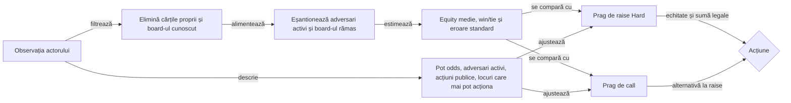
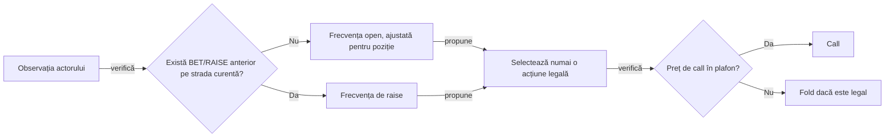

# Cerințe AI și evaluare

## Principiu

AI-ul nu trebuie să fie doar o funcție care alege o acțiune. Fiecare decizie trebuie să poată răspunde la:

- ce observație a primit;
- ce acțiuni erau legale;
- ce politică și versiune a folosit;
- ce buget de calcul a avut;
- ce utilitate a estimat;
- ce incertitudine a avut;
- ce fallback a aplicat dacă bugetul sau datele au eșuat.

## Niveluri

### L0 — legal fallback

Returnează o acțiune legală în timp bounded. Nu pretinde forță strategică.

### L1 — baseline

Preflop: poziție, perechi, broadway, suitedness și range-uri fixe. Postflop: hand class, pot odds, board texture și bet sizing simplificat.

### L2 — equity cu range condiționat (țintă)

Calculează equity împotriva unui range ponderat, actualizează range-ul din acțiuni și separă made hand, draw, bluff-catcher și air. Acest nivel nu este încă implementat complet.

### L3 — search

Folosește sampling al lumilor ascunse și rollout-uri cu adversari expliciți, dar nu confundă lumi fezabile cu distribuții calibrate.

### L4 — CFR / self-play

Folosește regret minimization, abstractizare de acțiuni și board-uri, evaluare de exploitability proxy și populații diverse de adversari.

## Implementarea curentă: equity Monte Carlo cu context public

`EQUITY-MC-0.4` estimează cota teoretică dintr-un pot comun prin eșantionarea cărților necunoscute. Returnează probabilitatea de victorie, egalitate și eroarea standard pentru bugetul YAML. Cota din potul comun presupune aceeași eligibilitate la jetoane, în timp ce poturile secundare au eligibilitate proprie.

Distribuția cărților adversarilor rămâne uniformă între combinațiile necunoscute. Acțiunile și poziția publice ajustează pragurile; istoricul de shove este un semnal limitat de agresivitate, nu o estimare de range. Prin urmare, aceasta este o **estimare de bază împotriva cărților aleatoare**, nu un solver și nu o estimare completă de range.

<strong>Legendă — observație și prag</strong>

- **Eșantionarea** estimează equity din cărțile necunoscute.
- **Contextul public** alimentează ambele praguri. Fiecare folosește ponderile acțiunii sale.
- **Acțiunea** este aleasă numai dintre opțiunile legale.

| Decizie | Calcul și limite |
|---|---|
| Call | Pentru un call pozitiv, `c = min(toCall, heroStack)`. Pragul pornește de la `ceil(100 × c / (pot + c))` și adaugă marjele de mod, adversari, poziție, agresiune, presiune, stivă și incertitudine. Intervalul final este 0–98%. |
| Raise contra unui preț pozitiv | Hard cu `raiseContext` calculează separat pragul de raise. Profilurile fără acest bloc folosesc pragul de call plus `raiseEdgePercent` și marja pentru adversari suplimentari. Motorul furnizează intervalul legal. |
| Bet | Când prețul este zero, pragul de valoare ține cont de adversari, agresiune, poziție și mod. Politica de bază calculează 25–75% din pot înainte de aplicarea limitelor legale. |

- **Incertitudine.** `uncertaintyZHundredths: 164` înseamnă `z = 1,64`. Componenta de prag este `ceil(z × standardError × 100)`, în puncte procentuale. Agresiunile proprii sunt excluse.
- **Reproductibilitate.** Seed-ul folosește valori stabile pentru rang, suită și stradă, alături de istoricul public. Același model, aceeași observație și același buget păstrează decizia după repornirea JVM. Strategiile mixte din arenă folosesc aceeași reprezentare a cărților pentru selecția de bluff și agresiune.
- **Configurare.** `equityDecision.contextWeights` declară ponderile. Parserul verifică setul exact de chei, iar versiunea deciziei identifică bugetul, modul, pragurile și ponderile. [Profil equity cu buget mărit](../../config/j6-policy-equity.yaml)
- **Limită de model.** Riscul de turneu este o marjă configurată. ICM, valoarea premiilor și equity pe straturile potului rămân în afara estimatorului.

### Profilul Hard al turneului local

- Normal păstrează adversarii check/call. În Hard, adversarii, coach-ul și preluarea folosesc aceeași politică contextuală cu 512 eșantioane pe decizie.
- Profilul reduce cu până la trei puncte procentuale pragul unei continuări preflop de cel mult două blinduri mari. Păstrează pragul obișnuit în fața unui all-in agresiv sau a riscului de eliminare și ține cont de costul apelului și eroarea estimării.
- `cheapPreflopDiscount` se calibrează cu aceleași ponderi de raise, blinduri și adversari în fiecare pereche. Compară stive inițiale scurte și adânci și urmărește deciziile la care discountul se poate aplica.

#### Raise cu preț pozitiv

Turneul local Hard folosește aceleași ponderi ca profilul YAML de arenă. Ponderile din `hardPressure.raiseContext` sunt exprimate în puncte procentuale, iar limita de angajare este un procent din stivă.

| Semnal | Aplicare |
|---|---|
| Preț și incertitudine | Pornește de la pot odds rotunjite în sus, eroarea de eșantionare, `baseMargin` și `raiseEdgePercent`. |
| Poziție | Adaugă `positionMargin` devreme și o scade pentru ultima jumătate a locurilor care pot acționa, rotunjită în jos la minimum un loc. Heads-up, ultimul actor beneficiază de reducere. |
| Adversari | Adaugă `multiwayMargin` pentru fiecare adversar suplimentar în mână. Numără până la trei agresiuni adverse pe strada curentă. Adaugă prime distincte când o acțiune ridică prețul cu cel puțin 75% din potul anterior sau când un all-in ridică prețul. |
| Acoperire | Plafonează suma la capacitatea celui mai bine finanțat adversar activ, ținând cont de contribuții. Exclude jucătorii care au dat fold sau și-au consumat stiva. Dacă plafonul cade sub minimul legal, evaluează call-ul sau fold-ul. |
| Angajarea stivei | La `commitmentThresholdPercent` din stiva rămasă, cere `commitmentMargin` în plus. Când echitatea justifică doar o mărire mai mică, plafonează suma imediat sub limită și verifică minimul legal. |

Discountul de call ieftin, reducerea de urgență pentru stivă scurtă și istoricul de shove rămân în pragul de call. Raise-ul folosește acțiunile adverse din mâna curentă. Jurnalul separă pragul de call `required` de `raiseRequired` și afișează plafonul `raiseCap` când motorul oferă raise.

#### Pariu de deschidere postflop

| Deschidere heads-up la preț zero | Condiții suplimentare |
|---|---|
| 1× pot | Turn sau river, cel puțin două perechi și equity conservatoare de minimum 76%. |
| 2× pot | Aceleași condiții, cu minimum 86%. |
| 3× pot | River, cel puțin chintă și minimum 94%. |

Equity conservatoare scade marja de incertitudine din cota estimată. Suma trebuie să intre în intervalul legal și să fie acoperită de stiva adversarului rămas. Politica încearcă mărimile descrescător și revine la mărimea de bază dacă niciuna nu se potrivește. [Configurația comparată în arenă](../../config/policy-tuning/j6-policy-hard-pressure.yaml)

#### Opțiunea de mărire din blindul mare

Arena poate activa `hardPressure.bigBlindValueRaise` pentru o comparație dedicată. Profilul implicit de turneu și configurațiile YAML fără această cheie folosesc valoarea `false`.

| Pas | Regulă |
|---|---|
| Oportunitate | Preflop, motorul oferă raise legal la preț zero, după ce adversarii au egalat blindul fără să mărească. |
| Prag | Equity conservatoare atinge maximul dintre 45% și cota egală din pot plus 20 de puncte procentuale. Cota egală este 100% împărțit la numărul de jucători încă în mână, inclusiv actorul. |
| Sumă | Ținta este jumătate din pot, în limitele motorului, sub stiva actorului și până la suma pe care o poate egala cel puțin un adversar activ. Când plafonul cade sub minimul legal, politica dă check. |
| Date | Pragul folosește cărțile proprii și informația publică. Probabilitatea de fold a adversarilor rămâne în afara acestui calcul. |

### Riscul public de stack și all-in

- **Oportunitate.** În turneu, locul fizic intră în numitor pentru o decizie preflop cu stiva rămasă peste 2 și cel mult 10 blinduri mari și cu un `ALL_IN` legal peste prețul call-ului. Open-shove și re-shove intră împreună, iar call-ul all-in rămâne în afara numitorului.
- **Moment.** `PublicShoveHistory` publică în arenă și în turneul Hard numai contoarele mâinilor încheiate. Android le reconstruiește la replay-ul acțiunilor acceptate. La raise-ul all-in curent, stiva rămasă este suma acțiunii publice, după blindurile deja plătite.
- **Loc.** `HoldemObservation` separă indexul compact al motorului de `physicalHeroSeat`, folosit în jurnal. Ordinea postflop exclude locurile foldate și fără jetoane, cu fallback la poziția din observație dacă lipsește harta publică.

| Pas | Efect asupra pragului de call |
|---|---|
| Estimare | Pentru `n` oportunități și `r` raise-uri all-in, posteriorul este `p = (r + p₀·k) / (n + k)`, din priorul YAML `p₀` și tăria `k`. |
| Încălzire | Ponderea dovezii crește până la `w = min(1, n / warmup)`. |
| Agregare | Calculează `(p₀ − p) · sensibilitate · w` pentru fiecare autor curent eligibil cu istoric. Media se rotunjește o singură dată și se aplică plafonul simetric YAML. |
| Interpretare | O frecvență peste prior reduce pragul. O frecvență sub prior îl crește. Fără istoric măsurat, ajustarea este zero. |

- **Presiune și eliminare.** Istoricul străzii semnalează un preț mare sau un all-in care l-a ridicat. În turneu, penalizarea de eliminare cere un call care angajează pragul configurat al stivei și un adversar activ care poate acoperi contribuția. La cel mult 10 blinduri mari se aplică discountul de urgență.
- **Domeniu.** Cash ignoră istoricul de shove de turneu. Frecvența publică descrie disponibilitatea de a împinge din stivă scurtă, iar cărțile necunoscute rămân distribuite uniform. Modelarea după poziție, preț, mărimea mesei, adversar, premii sau bounty cere măsurători separate.
- **Ablație.** Lineup-ul păstrează aceleași ponderi și schimbă numai sensibilitatea istoricului între control și varianta activă. Ambele joacă împotriva acelorași roluri și se rotesc prin locuri și poziții pe seed-uri identice. Agregați rotațiile în interiorul seed-ului înainte de a calcula incertitudinea.

## Acceptanță

O schimbare de decizie trebuie să păstreze legalitatea, reproductibilitatea și izolarea cărților ascunse. Evaluarea competitivă măsoară separat diferența față de control.

- **Control.** Compară pe un corpus ținut separat și pe seed-uri independente, cu același buget și mai multe stiluri de adversar.
- **Raport.** Include numărul de turnee și mâini, diferența pereche, intervalul de încredere și drawdown-ul când jurnalul îl măsoară.
- **Promovare competitivă.** Cere un avantaj față de control care depășește incertitudinea. O schimbare structurală poate fi acceptată pentru comportamentul verificat în teste și trebuie evaluată separat înainte de a i se atribui un avantaj la victorii.

### Citirea acțiunilor adverse preflop

| Semnal public | Cum se verifică |
|---|---|
| Ordine | Pornește după blindul mare și stabilește poziția între locurile care mai pot acționa. Separă poziția timpurie de jumătatea finală. |
| Succesiune | Distinge blindurile, un call anterior, un raise și un all-in care ridică prețul. Un all-in de egalare păstrează prețul existent. |
| Context | Grupează după prețul de call și stiva în blinduri mari. Compară adversarii în aceleași condiții înainte de a atribui efectul ordinii. |
| Predicție | Estimează frecvențele de fold și raise din turnee de antrenare. Pentru contexte rare, apropie estimarea de rata din grupul mai larg. Măsoară eroarea pe seed-uri separate și calculează incertitudinea pe turneu. |

Scorul Brier compară probabilitățile de acțiune cu răspunsurile observate. Equity estimează separat cota din pot pe cărțile vizibile. Un model de răspuns evaluat în arenă rămâne o ipoteză până la o comparație separată în politica de joc.

#### Candidat pentru răspunsul la raise

`hardPressure.responseModel` este un bloc YAML opțional de evaluare. Profilul fără bloc folosește pragul de raise obișnuit.

| Pas | Contract |
|---|---|
| Situație | Preflop, la preț pozitiv, cu un singur adversar activ care poate plăti suma propusă și păstra jetoane. Raise-ul trebuie să rămână sub pragul de angajare al actorului. |
| Context | Încadrează suma efectivă de plătit pentru adversar și stiva lui în blinduri mari. Din acțiunile publice separă prima mărire, mărirea după limp și re-raise-ul. Poziția este relativă la ordinea preflop a celor doi jucători activi. |
| Estimare | Numără fold-urile și măririle în situații comparabile, inclusiv all-in-urile care măresc. Sub `minSamples`, păstrează decizia de control. Pentru o celulă susținută, apropie frecvențele de grupul cu același preț și aceeași clasă de stivă. |
| Decizie | Un fold estimat peste reper poate coborî pragul de raise. Un re-raise estimat peste reper îl poate ridica. Ajustarea este plafonată, iar suma propusă și pragul de call se calculează independent. |
| Calificare | Folosește turnee distincte pentru estimarea frecvențelor, validarea probabilităților și comparația competitivă. Compară câștigurile în perechi și verifică legalitatea și reluarea jurnalelor. |

Jurnalul înregistrează cheia situației, cele două probabilități, numărul de observații și ajustarea. Versiunea politicii include amprenta setărilor și a numărătorilor.

- Pentru fiecare reacție, probabilitatea estimată este `(număr local + priorStrength × probabilitatea grupului) / (observații locale + priorStrength)`.
- Pragul de raise primește ajustarea rotunjită `foldWeight × (foldGrup − foldLocal) + raiseWeight × (raiseLocal − raiseGrup)`. Aici valorile locale sunt estimările după regularizare. Se aplică plafonul simetric `maxAdjustment`.
- Cu `penalizeRaisesOnly: true`, contribuția de re-raise folosește numai excesul pozitiv față de grup. Când probabilitatea estimată este sub reper, contribuția este zero. Omiterea cheii păstrează formula semnată.

| Profil de evaluare | Intervenție |
|---|---|
| Fold | Pune `raiseWeight` la zero. Ajustează pragul după diferența dintre frecvența estimată de fold și reper. |
| Penalizare re-raise | Pune `foldWeight` la zero și activează `penalizeRaisesOnly`. Ridică pragul când modelul estimează un exces de re-raise. |
| Control | Folosește același prag Hard cu blocul `responseModel` absent. |

Cele două profiluri folosesc aceiași numărători calibrați. La calificare, fixează lotul principal de adversari, regula de promovare și tratarea turneelor neterminate înainte de rulare.

#### Valoarea estimată a mărimii unui raise

`hardPressure.raiseEv` este opțional. Candidatul poate modifica suma când Hard a ales deja un raise preflop heads-up, cu preț pozitiv. Configurația cu `potPercents` folosește `responseModel` cu ponderile de prag la zero.

| Pas | Contract |
|---|---|
| Oferte | Compară suma de control, minimul legal și fracțiile configurate din potul după call. Păstrează suma de control în clasa ei de preț și cea mai apropiată sumă legală din cealaltă clasă. |
| Fold | Câștigul imediat este potul curent `P`. Jetoanele neacoperite din raise se întorc actorului. |
| Call | Contribuția este `e × (P + R + D) − R`, unde `R` este suma adăugată de actor și `D` este suma de plătit pentru adversar. `e` pornește de la equity conservatoare și scade discountul configurat. |
| Re-raise | Evaluează abandonul ulterior la `−R`. Scorul însumează cele trei ramuri ponderate cu probabilitățile estimate. |
| Alegere | Cere suport în ambele clase de preț, un câștig minim exprimat în blinduri mari și încadrarea sub plafonul de angajare. În celelalte situații păstrează suma de control. |

Valoarea este un scor în jetoane pentru dimensionare. Equity la call este aproximată, iar jocul ulterior și premiile de turneu rămân în afara scorului. [Valoarea așteptată pe ramuri](https://blog.gtowizard.com/what-is-expected-value-in-poker/)

Pentru diagnostic, reluarea offline poate continua ramura de call până la showdown, cu check pe străzile rămase și același pachet. Raportează separat cota observată, valoarea imediată în jetoane și rezultatul turneului. Datele oracolului rămân în analiza offline.

#### Comparația sumelor apropiate de control

Configurația alternativă `raiseEv.nearby` folosește frecvențele proprii din perechi de oferte. Profilul de arenă selectează o singură etapă prin `scope`.

- `FIRST_RAISE` acoperă prima mărire, inclusiv după limp dacă există un preț pozitiv.
- `RERAISE` cere o mărire anterioară în istoricul public al mâinii.

| Element | Regulă |
|---|---|
| Stivă efectivă | Minimum dintre stiva rămasă a actorului și stiva rămasă a adversarului, ajustată cu diferența contribuțiilor publice pe strada curentă. Astfel, plafonul este exprimat în jetoane de adăugat de actor. |
| Oferte | Calculează câte o sumă mai mică și mai mare. Pasul este cel mai mic dintre procentele configurate din blindul mare, suma de control și stiva efectivă, rotunjite în jos. Încadrează ofertele între minimul legal și plafonul dat de maximul legal, limita Hard de angajare și procentul maxim din stiva efectivă. O sumă de control peste plafon rămâne neschimbată. |
| Numărători | Reia prefixul aceleiași mâini pentru control și ofertă. Cheia numărătorilor combină etapa, poziția, clasa de preț și stiva adversarului pentru suma de control, plus direcția ajustării. Un rând include același număr de oportunități pentru ambele oferte. |
| Alegere | Verifică `minPairedSamples` pentru fiecare pereche. Compară fiecare ofertă cu controlul din aceeași pereche și alege câștigul estimat cel mai mare, peste marja configurată. Pragurile de call și raise rămân cele ale Hard. |

Configurația `nearby` se folosește separat de `potPercents` și `responseModel`. Jurnalul deciziei păstrează suma de referință, scorul în jetoane pentru referință și alegere, frecvențele estimate pentru alegere și amprenta profilului.

Pentru calificare, separă loturile de estimare, verificare a reacțiilor și turnee competitive.

- Raportează acoperirea pentru fiecare etapă și direcție. Un număr mare de turnee poate produce puține situații eligibile de re-raise.
- Verifică avantajul contra adversarilor agresivi pe stive scurte și adânci. Reexecută acțiunile și verifică limitele față de starea publică.

#### Re-raise mai mic evaluat până la decontare

Laboratorul poate reduce un re-raise de control deja ales, într-o situație preflop cu un singur adversar. Fiecare profil fixează pasul maxim și fracția maximă din stiva efectivă. Sunt eligibile și sumele de control care acoperă exact adversarul, dacă suma redusă îi lasă jetoane și respectă minimul legal.

| Pas | Ce măsurăm |
|---|---|
| Pereche | Reia același prefix și același pachet cu fiecare sumă. Ambii jucători continuă cu politicile de control până la decontare. |
| Reacție | Estimează `P(reacție ∣ stare, sumă)` pentru fold, call și re-raise. Separă prețul, stiva efectivă și ordinea măririlor înainte de agregare. |
| Valoare | Pentru fiecare reacție observată, calculează media jetoanelor nete de la decizie până la decontare, în blinduri mari. Valoarea ofertei este suma mediilor condiționate, ponderate cu probabilitățile reacțiilor. O reacție absentă are contribuție zero și medie neobservată. |
| Tranziție | Grupează perechile după ambele reacții. De pildă, `fold → call` compară aceleași situații înainte și după schimbarea sumei, inclusiv jocul ulterior și returnarea jetoanelor neacoperite. |
| Calificare | Fixează suportul minim pe seed-uri distincte, regula de selecție și criteriile competitive înainte de rulare. Calibrează pe un lot, validează valoarea pe altul și compară victoriile într-un al treilea. |

Pentru o clasă de cărți `H` și o reacție `R`, auditorul poate calcula `P(H ∣ R, stare, sumă)` din frecvența reacției în clasa `H`, înmulțită cu frecvența clasei înainte de reacție și împărțită la frecvența reacției. Un call poate selecta altă distribuție de mâini la fiecare ofertă. Diferența pereche până la decontare compară ofertele în aceleași stări.

- **Informații.** Politica folosește numai cărțile proprii și starea publică. Auditorul poate folosi cărțile ascunse pentru a explica selecția după decontarea ambelor ramuri.
- **Valoare aleatorie comună.** Repetă diagnosticul primei reacții cu aceeași valoare aleatorie la ambele oferte. Suma rămâne vizibilă pentru calculul prețului și al acțiunilor legale. Compară rezultatul cu reacția în care generatorul folosește istoricul fiecărei oferte.

#### Equity contra range-ului care răspunde

În arenă, estimăm separat range-ul de call și cel de re-raise pentru fiecare sumă. Profilul păstrează numărători de fold, call și re-raise pe clasă de cărți, bandă de stivă efectivă și pereche de oferte.

| Etapă | Contract |
|---|---|
| Calibrare | Rulează perechi din același prefix. Pentru adversarii LAG, egalizează extragerea la prima reacție prin normalizarea ultimei sume preflop doar în calculul extragerii. |
| Range | Împarte combinațiile în premium, perechi mici, două cărți de rang mare și rest. Pentru fiecare clasă, corectează frecvența observată cu proporția de combinații disponibile după excluderea cărților proprii. |
| Equity | Eșantionează un buget fix de runout-uri pe clasă și reutilizează aceleași eșantioane la ambele oferte. Fiecare reacție are propria medie ponderată, inclusiv jumătate de pot pentru egalitate. |
| Scor | La call folosește equity contra range-ului care plătește. La re-raise, compară abandonul cu decontarea la stiva efectivă, folosind equity contra range-ului care mărește. Această decontare este o aproximare în scorul de selecție. |
| Validare | Măsoară eroarea equity față de un showdown de control și față de estimatorul uniform. Verifică separat jetoanele realizate sub politicile de continuare și victoriile în turnee pereche. |

- Ponderea unei clase la o reacție este numărul de răspunsuri din clasă înmulțit cu `combinații disponibile / combinații totale în clasă`.
- Probabilitatea reacției împarte ponderea ei la ponderea tuturor răspunsurilor. Equity condiționată este media equity pe clase, cu ponderile acelei reacții.

Datele ascunse intră în numărătorile offline și în oracol. La alegerea sumei, candidatul vede numai cărțile proprii, stiva, prețul și istoricul public. Când lipsesc date pentru o ofertă sau o bandă, păstrează suma de control.

#### Inițiativa și poziția

- **Inițiativă.** Prima mărire stabilește un preț nou. În simulare, compară call-ul și raise-ul din aceeași stare a primului actor și măsoară reacția imediată.
- **Poziție.** În heads-up, butonul acționează primul preflop și ultimul postflop. Segmentează rezultatele după stradă, prima mărire și re-raise. [Ordinea heads-up](https://www.pokerstars.com/poker/learn/news/strategy-to-play-heads-up-poker/)
- **Comparație.** Reexecută două sume din același prefix pe o copie a mâinii și validează prețul efectiv. Estimează frecvențele pe turnee separate și măsoară victoriile într-un lot competitiv independent. [Dimensiuni de acțiune în jocuri cu informație incompletă](https://arxiv.org/abs/1705.02955)

## Politică mixtă de bluff pentru laborator

Politica experimentală `BLUFF-MIXED-0.1` explorează o deschidere minimă după check, cu frecvență și fereastră de poziție configurate. [YAML-ul politicilor](../../config/j6-policy.yaml)

- **Eligibilitate.** Postflop, As pe board, două cărți proprii de ranguri diferite, fără As în mână și fără potrivire cu rangurile de pe board. Actorul este în poziție târzie, istoricul străzii conține cel puțin un check și nicio altă acțiune, iar `BET` este legal.
- **Decizie.** Pe o observație eligibilă, o valoare deterministă decide dacă politica alege bet-ul minim. Restul cazurilor trec la TAG, inclusiv când există un preț de call.
- **Evaluare.** Raportați frecvența bluff-urilor, chips/hand și drawdown pe profil adversar. Triggerul folosește semnale vizibile și nu estimează range, fold equity, textura completă a board-ului sau istoricul de call.

## Coordonata de poziție și limita informației

- `positionFromButton = 0` identifică butonul, ultimul actor după flop în ordinea inițială. Valorile cresc în ordinea locurilor de la masă.
- Fereastra târzie include butonul și cele `n − 1` locuri dinaintea lui, plafonată la numărul de locuri rămase.

Politica primește numai `HoldemObservation`: propriile două cărți, board-ul public până la strada curentă, miza, stivele vizibile, acțiunile publice și setul de mutări legale. Seed-ul, pachetul și cărțile ascunse ale adversarilor rămân în motor și în auditor. În evaluările cu distribuții fixe, auditorul verifică proiecția la fiecare decizie, iar distribuția completă se dezvăluie numai după încheierea mâinii.

- Pentru equity, adversarii nefoldați rămân eligibili în estimare, inclusiv când sunt all-in.
- Ordinea de acțiune exclude locurile all-in. Politica primește istoricul public și vede doar cărțile proprii și board-ul deja deschis.

## Stiluri comparate în laborator

| Stil | Comportament măsurat | Limita interpretării |
|---|---|---|
| TAG | Pereche sau As preflop, call limitat după preț și fold conservator | Baseline-ul este deliberat simplu; nu este un solver. |
| Calling station | Check gratuit, altfel call; nu ridică voluntar | Servește drept model de adversar pasiv, nu candidat de câștig. |
| Pressure | Deschidere minimă legală; răspunde la all-in scurt cu cărți private mari | Nu estimează equity ori range advers. |
| Loose-aggressive | Deschideri și raise-uri minime deterministe, cu plafon configurabil pentru call | Frecvențele sunt de explorare și se compară înainte de a fi promovate. |
| Bluff mixt | Semnal public de As, check-uri și poziție târzie, cu fallback TAG | Nu este încă echilibrat după frecvențe de call sau fold equity. |
| Equity Monte Carlo | Eșantionare reproductibilă, pot odds și ponderi publice de context | Range-ul adversarilor este uniform; eșantioanele mici au eroare vizibilă și nu confirmă EV. |

## Prioritatea acțiunii loose-aggressive

Politica separă deschiderea de continuarea agresiunii în istoricul **străzii curente**:

<strong>Legendă — deschidere și re-raise</strong>

- **Open** folosește frecvența ajustată pentru poziție.
- **Re-raise** se aplică după agresiune pe strada curentă.
- **Call** rămâne condiționat de preț și opțiunile legale.

| Semnal | Comportament |
|---|---|
| Open | Prima mărire preflop fără raise anterior, sau un `BET` fără preț, folosește frecvența de deschidere. |
| Re-raise | După agresiune pe strada curentă, politica folosește `raiseFrequencyPercent`. Clasificarea pornește din nou pe strada următoare. |
| Poziție | `latePositionAdjustmentPercent` crește frecvența de open pentru buton și cutoff, o scade în rest și plafonează rezultatul la 0–100%. |
| Call | `maxCallPotPercent` compară suma de plătit cu potul înainte de call. |
| Mărime | Politica de bază deschide sau mărește cu suma minimă legală. |

Frecvențele de open și re-raise folosesc o valoare deterministă calculată din observația actorului. Ajustarea pozițională se aplică numai la open. [Politica loose-aggressive](../../holdem-ai/src/main/java/ro/atf/holdem/ai/LooseAggressivePolicy.java)

## Sizing relativ la pot

| Caz | Ce calculează `PotSizedPolicy` |
|---|---|
| `BET` | Mărimea pleacă de la fracția configurată din potul curent și respectă minimul legal. |
| `RAISE` | Calculează incrementul din potul după call și adaugă suma de call la acțiune. |
| Limită | Păstrează mărimea de bază dacă rezultatul o micșorează, depășește maximul legal sau consumă întreaga stivă. |

- **Configurații.** `betPotPercent: 0` dezactivează învelișul. Valorile 50, 100 și 150 compară sizing-ul în cohortele `sized` și `legacy-pot`. În `config/policy-tuning/` sunt și variante conservatoare, neutre pozițional și agresive.
- **Control.** Mențineți aceleași seed-uri, mărimi de masă, niveluri și locuri. Înlocuiți candidatul cu TAG sau cu varianta de control declarată. `bluff-always` servește doar proba declanșatorului.
- **Interpretare.** Raportați separat mărimea relativă la pot, câștigul prin fold și evoluția stivei. Stratificați după poziție, mărimea mesei și profilul blindurilor. Pentru estimarea EV sunt necesare date suplimentare față de fold-uri și victorii observate.
- **Trasabilitate.** Versiunea din jurnal include parametrii YAML care influențează decizia.

## Lecții pentru evaluarea unei politici

| Întrebare | Metodă |
|---|---|
| Din ce a rezultat decizia? | Păstrează observația publică, acțiunile legale, versiunea și hash-ul YAML. Auditorul verifică separat distribuția și decontarea, inclusiv eligibilitatea în fiecare pot. |
| Ce aduce o regulă nouă? | Compară candidatul cu un control care schimbă o singură pondere. Rulează ambele variante cu aceleași distribuții, buget și adversari. Numără deciziile unde ponderea schimbă efectiv pragul sau acțiunea. |
| Cât contează poziția și sizing-ul? | Rotește actorul și butonul pe aceeași distribuție. Compară separat deschiderea și re-raise-ul, precum și pariurile raportate la pot și la stiva efectivă. |
| Când merită promovată? | Separă reglajul de holdout, agregă rotațiile per seed și raportează incertitudinea pe 4, 5 și 6 locuri. Verifică direcția efectului pe adversari diferiți și separat în cash și turneu. |

Păstrează pentru fiecare lecție un jurnal reprezentativ, verificarea independentă și proveniența necesară reluării. Rezumatele loturilor și seed-urile concrete apar în directorul extern de lucru. O greșeală stabilă intră ca test de componentă cu o distribuție minimă. [Reguli și replay](TOURNAMENT_RULES.md) · [Strategia de testare](../testing/TEST_STRATEGY.md)

## Metrici

- chips/hand și big blinds/100;
- EV brut și EV după rake simulată;
- showdown equity error;
- fold/call/raise calibration;
- variance și maximum drawdown;
- decizii timeout/fallback;
- regret proxy și exploatare de către adversari;
- distribuția sizing-urilor și frecvențele pe street.

Win-rate-ul singur nu este suficient: pokerul are varianță mare și un eșantion pozitiv poate fi noroc.
