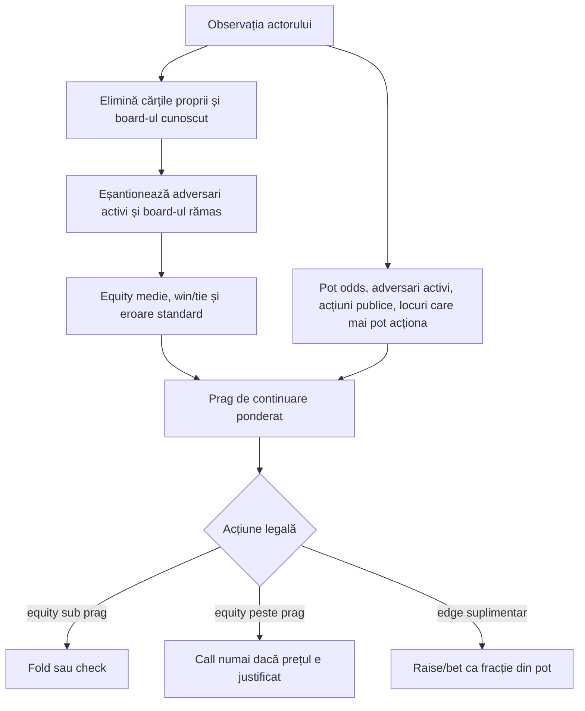
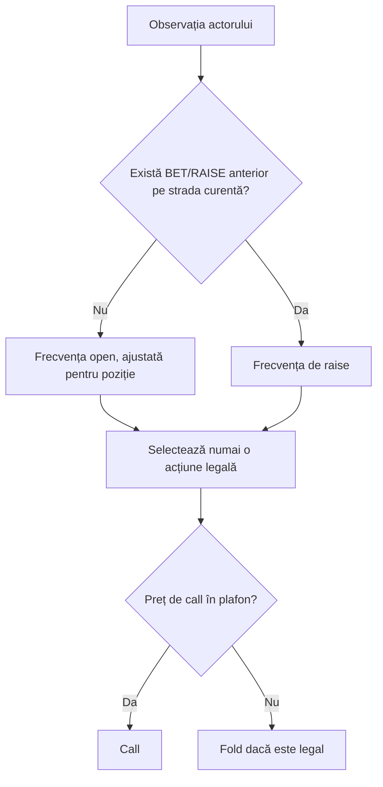

# Cerințe AI și evaluare

## Principiu

AI-ul nu trebuie să fie doar o funcție care alege o acțiune. Fiecare decizie trebuie să poată răspunde la:

- ce observație a primit;
- ce acțiuni erau legale;
- ce politică și versiune a folosit;
- ce buget de calcul a avut;
- ce utilitate a estimat;
- ce incertitudine a avut;
- ce fallback a aplicat dacă bugetul sau datele au eșuat.

## Niveluri

### L0 — legal fallback

Returnează o acțiune legală în timp bounded. Nu pretinde forță strategică.

### L1 — baseline

Preflop: poziție, perechi, broadway, suitedness și range-uri fixe. Postflop: hand class, pot odds, board texture și bet sizing simplificat.

### L2 — equity cu range condiționat (țintă)

Calculează equity împotriva unui range ponderat, actualizează range-ul din acțiuni și separă made hand, draw, bluff-catcher și air. Acest nivel nu este încă implementat complet.

### L3 — search

Folosește sampling al lumilor ascunse și rollout-uri cu adversari expliciți, dar nu confundă lumi fezabile cu distribuții calibrate.

### L4 — CFR / self-play

Folosește regret minimization, abstractizare de acțiuni și board-uri, evaluare de exploitability proxy și populații diverse de adversari.

## Implementarea curentă: equity Monte Carlo cu context public

`EQUITY-MC-0.2` este primul candidat care estimează probabilistic cărțile ascunse. La fiecare decizie, evaluatorul elimină din pachet cărțile proprii și board-ul public, apoi eșantionează fără înlocuire mâinile adversarilor încă activi și cărțile de board rămase. Returnează cota teoretică dintr-un pot comun, probabilitatea de victorie, probabilitatea de egalitate și eroarea standard pentru bugetul YAML. Seed-ul derivat din observație face aceeași decizie reproductibilă. Cota nu este încă decontare probabilistică pe straturi: deciziile cu all-in-uri și poturi secundare nu trebuie evaluate ca și cum fiecare adversar ar fi eligibil la întregul pot.

Distribuția adversarilor este momentan uniformă între toate combinațiile necunoscute. Acțiunile publice schimbă pragul de risc și poziția, dar încă nu calibrează rangul fiecărui adversar într-un range propriu. Prin urmare, aceasta este o **estimare de bază împotriva cărților aleatoare**, nu un solver și nu o estimare completă de range.

Pragul de call pornește de la `ceil(min(toCall, heroStack) / (pot + min(toCall, heroStack)))` și adaugă marja modului cash/turneu, câte un adaos pentru fiecare adversar în plus, agresiunile adversarilor pe strada curentă, poziția și penalizarea de incertitudine `z × standardError`. În YAML, `uncertaintyZHundredths: 164` reprezintă `z = 1,64`. Acțiunile proprii nu sunt numărate drept agresiune adversă. Marjele se plafonează înainte de comparație pentru a evita pragurile imposibile.

La un preț existent, call-ul cere depășirea pragului; raise-ul cere și `raiseEdgePercent`, plus o marjă suplimentară în poturi cu mai mulți adversari. Fără preț, valoarea minimă de bet este ajustată cu numărul adversarilor, agresiunile publice, poziția și modul de joc. Sizing-ul crește odată cu avantajul estimat, dar se limitează la o fracție configurată din pot și evită all-in-ul implicit. Modul de turneu aplică o marjă simplă de risc; el **nu** calculează ICM sau valoarea reală a premiilor. Motorul de decontare calculează separat straturile poturilor, însă estimatorul de decizie încă nu proiectează simulările pe aceste straturi.

Toate ponderile de context se află în `equityDecision.contextWeights` din YAML. Fișierul [candidatului equity](../../config/j6-policy-equity.yaml) folosește un eșantion mai mare decât configurația mixtă. Parserul respinge chei lipsă sau suplimentare, iar versiunea din fiecare acțiune include bugetul, modul, pragurile și ponderile folosite.

### Riscul public de stack și all-in

În modul turneu, aceeași observație expune blind-ul mare și contribuția vizibilă a fiecărui loc, în ordinea stabilă din `SEATS`. Politica folosește istoricul public al străzii pentru a adăuga un adaos de risc după un preț mare sau un all-in care a ridicat prețul. Separat, estimează dacă un call ar consuma pragul configurat al stivei și dacă un adversar nefoldat poate acoperi contribuția totală a actorului. Un stack de cel mult zece blind-uri mari activează discountul de urgență configurat. Toate pragurile sunt YAML și au efect numai în turneu; situațiile fără call nu primesc penalizare de eliminare.

Aceste semnale **nu** deduc încă probabilități de cărți din stilul individual al adversarului, ICM, premii, bounty sau equity exactă pe straturi. „Poate acoperi” este o verificare a stivelor și contribuțiilor publice; nu spune dacă acel adversar va plăti și nu garantează că este corect să riști eliminarea. Adaosurile de prag sunt o aproximare explicită, testată separat de simularea Monte Carlo.

Experimentul pereche folosește două fișiere YAML: `equity-baseline` dezactivează adaosurile de bet mare/all-in/eliminare și discountul de short-stack; `equity-stack-aware` le activează. Ambele joacă simultan împotriva unor roluri distincte și sunt rotite prin locuri și poziții de buton pe seed-uri identice. Comparația agregă mai întâi rotațiile din fiecare seed, apoi tratează seed-ul ca unitate independentă. Încrederea statistică nu se mărește doar pentru că au fost rulate mai multe rotații ale aceluiași seed.

`HoldemObservation` expune separat indexul compact folosit de motor și `physicalHeroSeat`, identitatea publică stabilă necesară interpretării jurnalului. Pentru poziția postflop, politica elimină din ordinea de acțiune locurile care au dat fold și locurile fără jetoane. Când istoria publică nu oferă harta locurilor, folosește fallback-ul de poziție din observație.

## Acceptanță

O politică nouă se acceptă numai dacă:

- bate baseline-ul pe un corpus ținut separat și pe seed-uri independente, nu doar pe rotații pereche ale aceluiași seed;
- nu regresează legalitatea sau timeout-ul;
- păstrează aceeași decizie pe replay determinist;
- are rezultate raportate cu număr de turnee și mâini, seed-cluster, interval de încredere și drawdown;
- este testată împotriva mai multor stiluri, nu doar împotriva propriei versiuni;
- nu primește informație ascunsă accidental.

## Politică mixtă de bluff pentru laborator

`BLUFF-MIXED-0.1` este o politică experimentală de explorare, nu o evaluare de rang și nu o promisiune de joc optim. Configurația din [YAML-ul politicilor](../../config/j6-policy.yaml) stabilește frecvența și lățimea pozițiilor târzii. Bluff-ul este eligibil numai postflop, cu As vizibil pe board, fără As și fără pereche proprie cu board-ul, după ce acțiunile publice de pe strada curentă au fost check, în poziție târzie și când motorul oferă o deschidere legală. Atunci alege deschiderea minimă cu frecvența deterministă configurată. În celelalte situații delegă baseline-ului TAG. Nu bluffează prin acțiunea `BET` când actorul se confruntă cu un preț; acolo folosește acțiunile legale alese de fallback.

Amestecul determinist face replay-ul reproductibil și oferă o frecvență măsurabilă între observațiile eligibile. Este un trigger bazat pe semnal vizibil simplu; nu modelează încă range-ul adversarilor, fold equity, textura completă a board-ului sau istoricul de call. Prin urmare, cohortele măsoară efectul acestei explorări împotriva unor stiluri fixe, nu demonstrează că frecvența este optimă. Rapoartele trebuie să separe frecvența bluff-urilor, chips/hand, drawdown-ul și rezultatele pe fiecare profil adversar; o creștere izolată a câștigurilor nu validează regula.

## Coordonata de poziție și limita informației

`positionFromButton = 0` înseamnă butonul; valorile cresc pe locurile următoare în ordinea mesei. După flop, butonul acționează ultimul. O fereastră târzie de `n` locuri cuprinde butonul și cele `n - 1` locuri dinaintea lui. Dacă masa se micșorează prin eliminări, fereastra efectivă se limitează la numărul de locuri rămase.

Politica primește numai `HoldemObservation`: propriile două cărți, board-ul public până la strada curentă, miza, stivele vizibile, acțiunile publice și setul de mutări legale. Seed-ul, pachetul și cărțile ascunse ale adversarilor rămân în motor și în auditor. În evaluările cu distribuții fixe, auditorul verifică proiecția la fiecare decizie, iar distribuția completă se dezvăluie numai după încheierea mâinii.

Numărul adversarilor folosit la equity este cel al jucătorilor care nu au dat fold; un adversar all-in rămâne în distribuția de cărți și în cota potului. Pentru calculul poziției de acțiune, locurile all-in nu mai sunt considerate actori. Istoricul este folosit numai pentru informații publice; politica nu citește seed-ul sau cărțile ascunse.

## Stiluri comparate în laborator

| Stil | Comportament măsurat | Limita interpretării |
|---|---|---|
| TAG | Pereche sau As preflop, call limitat după preț și fold conservator | Baseline-ul este deliberat simplu; nu este un solver. |
| Calling station | Check gratuit, altfel call; nu ridică voluntar | Servește drept model de adversar pasiv, nu candidat de câștig. |
| Pressure | Deschidere minimă legală; răspunde la all-in scurt cu cărți private mari | Nu estimează equity ori range advers. |
| Loose-aggressive | Deschideri și raise-uri minime deterministe, cu plafon configurabil pentru call | Frecvențele sunt de explorare și se compară înainte de a fi promovate. |
| Bluff mixt | Semnal public de As, check-uri și poziție târzie, cu fallback TAG | Nu este încă echilibrat după frecvențe de call sau fold equity. |
| Equity Monte Carlo | Eșantionare reproductibilă, pot odds și ponderi publice de context | Range-ul adversarilor este uniform; eșantioanele mici au eroare vizibilă și nu confirmă EV. |

## Prioritatea acțiunii loose-aggressive

Politica separă deschiderea de continuarea agresiunii în istoricul **străzii curente**:

Prima mărire preflop este un open când istoricul nu conține încă un raise preflop; nu se confundă cu re-raise-ul blindurilor sau al unui raise anterior. Un BET fără preț folosește frecvența open. După o agresiune publică pe strada curentă, o nouă mărire folosește frecvența `raiseFrequencyPercent`. Acțiunile de pe străzile încheiate nu schimbă clasificarea străzii noi.

`latePositionAdjustmentPercent` se adună la frecvența open în buton și cutoff și se scade în pozițiile timpurii, cu limitare la intervalul 0–100. Fereastra de poziție târzie este cele două locuri care acționează cel mai târziu postflop. Ajustarea schimbă numai probabilitatea deterministă de a deschide; ea nu schimbă frecvența de re-raise sau plafonul de call. Pragul este calculat din observația actorului și din seed-ul mâinii, astfel încât replay-ul aceleiași observații să producă aceeași acțiune.

`maxCallPotPercent` compară suma necesară pentru call cu potul vizibil înaintea call-ului. Un call scump nu devine justificat doar fiindcă politica a deschis anterior. Deschiderea și re-raise-ul rămân limitate la suma minimă legală în politica de bază.

## Sizing relativ la pot

`PotSizedPolicy` este un înveliș experimental peste o politică de acțiune. Pentru BET calculează mărimea din potul curent; pentru RAISE calculează incrementul din potul după call, apoi adaugă call-ul la contribuția acțiunii. Un rezultat sub mărimea de bază nu micșorează acțiunea legală existentă. Un rezultat peste plafonul legal sau care ar consuma toată stiva este respins, iar politica revine la acțiunea de bază; nu transformă tacit un sizing într-un all-in.

Configurațiile `betPotPercent` de 50, 100 și 150 sunt instrumente de comparație, nu trepte de dificultate și nu estimări ale equity-ului. Un BET mai mare poate obține mai multe fold-uri observate, dar acestea nu demonstrează că adversarul a foldat din cauza acelei mărimi, că mâna a fost profitabilă sau că strategia are EV pozitiv. Evaluatorul notează separat mărimea raportată la pot, fold-win-ul mâinii și evoluția stivei. Datele sunt grupate după poziție, mărimea mesei și profilul de blind-uri; seed-urile repetate la rotația butonului sunt perechi intenționate, nu eșantioane independente.

Versiunea de policy din jurnal include valorile YAML care influențează decizia. Astfel, două variante cu aceeași clasă Java, dar frecvențe sau sizing diferite, nu apar ca aceeași politică în audit.

În proba controlată, `bluff-always` ridică temporar frecvența la 100% doar ca să testeze accesibilitatea trigger-ului. Nu este profil de produs și nu intră în comparația turneelor.

Fișierele de sub `config/policy-tuning/` definesc variante conservatoare, neutre pozițional, agresive și cu sizing relativ la pot de 50/100/150%. `betPotPercent: 0` dezactivează învelișul de sizing; valorile pozitive sunt folosite de cohortele `sized` și `legacy-pot`. Se compară cu aceleași seed-uri, mărimi de masă, niveluri și locuri candidate înlocuite cu TAG sau cu o variantă explicită de control. O variantă nu se promovează pe câteva distribuții fixe sau pe procentul de turnee câștigate: acestea sunt probe de comportament, nu estimări stabile de EV.

## Metrici

- chips/hand și big blinds/100;
- EV brut și EV după rake simulată;
- showdown equity error;
- fold/call/raise calibration;
- variance și maximum drawdown;
- decizii timeout/fallback;
- regret proxy și exploatare de către adversari;
- distribuția sizing-urilor și frecvențele pe street.

Win-rate-ul singur nu este suficient: pokerul are varianță mare și un eșantion pozitiv poate fi noroc.
