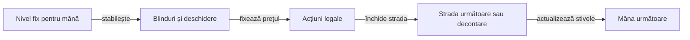
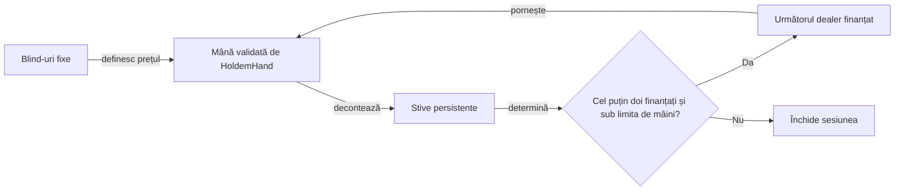

# Sesiuni Hold’em la o singură masă

[Profilul YAML de turneu](../../config/j6-tournaments.yaml) declară mesele de 4, 5 și 6 locuri, stiva inițială și nivelurile.

- `TournamentArena` gestionează timpul, eliminările și creșterea blindurilor.
- `CashTableArena` păstrează stivele și blindurile fixe între mâini.
- Ambele folosesc același motor de mână și aceleași reguli de plată.

## Reguli de turneu

| Moment | Regulă |
|---|---|
| Început de mână | Locurile cu zero jetoane sunt eliminate. Jucătorii păstrează locul fizic și butonul se deplasează printre locurile finanțate. |
| Alegerea nivelului | Indicele pornește de la zero. Adună numărul intervalelor complete de `levelSeconds` și eliminările cumulative, apoi se plafonează la ultimul nivel YAML. |
| Prag în timpul mâinii | Mâna păstrează nivelul cu care a început. La mâna următoare se aplică toate pragurile acumulate și eliminările nou confirmate. |
| Rămân doi jucători | Butonul postează small blind și joacă primul preflop. Celălalt loc joacă primul pe străzile următoare. Big blind-ul trece la următorul loc eligibil după big blind-ul anterior. |
| Rămâne un jucător | Turneul se încheie după decontare. Toate jetoanele mesei se află în stiva câștigătorului. |

## Cum se licitează



<details>
<summary><strong>Legendă — de la blinduri la decontare</strong></summary>

- **Nivelul** fixează blindurile până la finalul mâinii.
- **Motorul** calculează opțiunile legale pentru actorul curent.
- **Decontarea** actualizează stivele înaintea următoarei mâini.

</details>

Toate sumele de acțiune sunt jetoanele pe care actorul le pune **acum**. Preflop, blindul mare stabilește prețul nominal și pasul inițial de raise. După flop, valoarea `minimumOpen` stabilește prima deschidere completă.

| Situație | Regulă |
|---|---|
| Raise all-in scurt | Poate crește prețul. Pentru un actor care a acționat, dreptul de raise se redeschide când creșterea cumulată de la ultima sa acțiune atinge ultimul pas complet. |
| Momentul verificării | Motorul verifică pragul la tura actorului. O creștere scurtă ulterioară păstrează dreptul deja redeschis. |
| Call parțial | Actorul plătește cel mult stiva rămasă și poate câștiga straturile acoperite de contribuția lui. Un loc foldat poate finanța un strat. |
| Decontare | Contribuțiile determină straturile, iar eligibilitatea determină beneficiarii. Surplusul neacoperit se returnează. Jetonul indivizibil merge la primul câștigător eligibil în sens orar după buton. |

Nivelurile, ritmul și creșterea la eliminare sunt convențiile laboratorului. Pentru licitare, heads-up și împărțire, consultați [regulile Poker Tournament Directors Association](https://www.pokertda.com/view-poker-tda-rules/).

## Reproducere offline

După `mvn test`, porniți `TournamentArena` cu clasele core, AI și arena și cu JAR-ul SnakeYAML din cache-ul Maven. CLI-ul simulează 12 secunde per mână.

### Candidatul și controlul

| Argument CLI | Rol |
|---|---|
| Profil YAML, jurnal nou și număr de turnee | Fixează regulile, ieșirea și numărul de turnee pentru fiecare mărime de masă. |
| Seed, stil și YAML de politică | Permit replay și alegerea ponderilor candidatului. YAML-ul se încarcă și când se specifică offsetul. |
| `buttonOffset` | Rotește primul buton pe același flux de seed-uri. Candidatul și controlul folosesc același offset. |

- **Stiluri.** Folosiți `bluff` sau aliasul `mixed` pentru explorare postflop, `calling` pentru joc pasiv, `pressure` pentru presiune minimă legală și `loose` pentru frecvențele și plafonul din `looseAggressive`. `sized` aplică mărimile relative la pot.
- **Pereche.** `control` înlocuiește locurile candidate cu TAG. `equity` folosește Monte Carlo contextual pe aceleași locuri, alături de adversarii de referință TAG, calling station și pressure.
- **Replay și reglaj.** `legacy`, `legacy-loose`, `legacy-pot` și `legacy-equity` refac cohorta istorică. Pentru un reglaj loose-aggressive, schimbați numai YAML-ul din `config/policy-tuning/`, păstrând seed-urile, nivelurile, locurile și adversarii.
- **Jurnal.** Fiecare decizie leagă poziția, strada, potul, prețul de call și stiva dinaintea acțiunii de versiunea parametrilor. Auditați fiecare jurnal și rulați `node scripts/compare-tournament-cohorts.cjs <candidat> <control>`.

### Rotația rolurilor și a butonului

- `run-button-position-tournaments.ps1` compară pressure, loose și sizing 50/100/150 la offseturile 0–5, în profilurile standard și de stres. `audit-button-rotations.cjs` verifică fluxul de seed-uri, perechile și acoperirea pozițiilor. Când mutați butonul, cărțile se redistribuie între locurile fizice.
- `TournamentStrategyArena` validează [lineup-ul strict](../../config/j6-strategy-lineups.yaml), rotește rolurile și le leagă de locuri în evenimentele `STRATEGY`. Pentru același seed și același offset, rotația rolurilor păstrează distribuția.
- `config/j6-strategy-lineups-shortstack.yaml` include rolul adversarial cu plafon de 8 blinduri mari. El împinge preflop cu pereche de nouari sau mai mare, A-T sau mai bun ori K-Q, dacă all-in-ul este legal. În rest revine la TAG. Testele verifică declanșarea, fallback-ul și schema lineup-ului pentru 4–6 locuri.
- `run-strategy-rotation-tournaments.ps1` rulează toate rotațiile rolurilor și butonului în profilul standard și de stres. Folosiți `-LineupFile`, `-SeatCounts`, `-ProfileNames` și `-SeedsPerSeatCount` pentru a selecta matricea.

| Opțiune sau dovadă | Condiție |
|---|---|
| `-Append` | Refolosește un jurnal numai după un nou audit independent. O urmă incompletă sau invalidă oprește rularea. |
| `-MavenRepository` | Identifică depozitul extern pentru SnakeYAML. |
| `-SourceCommit` și `-SourceDirty` | Pentru o copie fără `.git`, consemnează commitul complet și marcajul modificărilor necomise. |
| Auditor și sumarizator | `audit-tournament.cjs` reconstruiește stivele, contribuțiile, poziția, call-ul, legalitatea, all-in-urile și decontarea. `summarize-strategy-rotation-tournaments.cjs` agregă stivele și răspunsurile după rol, poziție și seed. |

### Istoricul public și interpretarea

- **Context.** Jurnalul deciziei consemnează blindul mare, locurile active, stivele, contribuțiile, fold-urile, all-in-urile clasificate ca raise sau call, statisticile publice și acțiunile legale. Politica vede doar observația actorului.
- **Shove.** `PublicOpponentTendency` măsoară oportunitățile pe loc fizic, pentru o stivă preflop de peste 2 și cel mult 10 BB, cu raise all-in legal. Contoarele se actualizează după decontare, iar raise-ul curent este clasificat din suma acțiunii. Profilul baseline are sensibilitatea zero. [Calcul și configurare](AI_REQUIREMENTS.md#riscul-public-de-stack-și-all-in)
- **Audit.** `audit-tournament.cjs --require-public-shove-history` reconstruiește oportunitățile din acțiunile legale și confruntă istoricul anterior fiecărei decizii.
- **Unitatea statistică.** Comparați candidat și control la același seed, profil, număr de locuri și offset. Sumarul elimină offseturile redundante la mesele mici și grupează loturile după intervalele de seed. Rotațiile aceluiași seed rămân măsurători pereche.
- **Fold.** Un fold care urmează unei agresiuni arată succesiunea acțiunilor. Pentru interpretare, comparați mărimea relativă la pot, câștigurile fără showdown, evoluția stivei și poziția. Estimarea fold equity sau EV cere dovezi suplimentare.

### Rotația aceleiași distribuții

Setați `HOLDEM_DATA_ROOT` la directorul extern de date și `HOLDEM_MAVEN_REPOSITORY` la cache-ul Maven folosit la compilare.

- **Distribuție controlată.** `PositionRotationExperiment` păstrează cărțile private, board-ul și stivele pe loc fizic și rotește butonul prin șase poziții.
- **Politici.** TAG, calling, pressure, loose, bluff și equity primesc `HoldemObservation`. Calling stations sunt adversarii de referință. `bluff-always` exercită declanșatorul.
- **Oracol.** Auditorul verifică observația și legalitatea fiecărei mutări. Comparația de stivă folosește TAG în același loc.

```powershell
$run = Join-Path $env:HOLDEM_DATA_ROOT ('position-' + (Get-Date -Format 'yyyyMMdd-HHmmss'))
New-Item -ItemType Directory -Path $run | Out-Null
$yaml = Join-Path $env:HOLDEM_MAVEN_REPOSITORY 'org/yaml/snakeyaml/2.2/snakeyaml-2.2.jar'
$cp = "holdem-core/target/classes;holdem-ai/target/classes;holdem-arena/target/classes;$yaml"
java -cp $cp ro.atf.holdem.arena.PositionRotationExperiment config/j6-policy.yaml "$run\positions.psv"
node scripts/audit-position-rotations.cjs "$run\positions.psv"
```

Auditul compară aceeași distribuție fizică între toate rotațiile, confirmă că actorul vede numai propriile cărți și board-ul ajuns până la strada curentă și verifică acțiunea în meniul legal. Aceste mâini controlate validează mecanisme și sensibilitatea la poziție; nu estimează singure forța unui stil în turneu.

Exemplu PowerShell, din rădăcina proiectului (JAR-ul SnakeYAML trebuie să existe în repository-ul Maven local):

```powershell
$run = Join-Path $env:HOLDEM_DATA_ROOT ('tournament-' + (Get-Date -Format 'yyyyMMdd-HHmmss'))
$yaml = Join-Path $env:HOLDEM_MAVEN_REPOSITORY 'org/yaml/snakeyaml/2.2/snakeyaml-2.2.jar'
$cp = "holdem-core/target/classes;holdem-ai/target/classes;holdem-arena/target/classes;$yaml"
New-Item -ItemType Directory -Force -Path $run | Out-Null
java -cp $cp ro.atf.holdem.arena.TournamentArena config/j6-tournaments-stress.yaml "$run\mixed.trace" 50 7000 mixed
java -cp $cp ro.atf.holdem.arena.TournamentArena config/j6-tournaments-stress.yaml "$run\control.trace" 50 7000 control
node scripts/audit-tournament.cjs "$run\mixed.trace" --require-layers
node scripts/audit-tournament.cjs "$run\control.trace" --require-layers
node scripts/compare-tournament-cohorts.cjs "$run\mixed.trace" "$run\control.trace"
```

Pentru fixture-ul de redeschidere, adaugă `-Dj6.challenge.trace=<cale-nouă>` la `mvn test`, apoi rulează auditorul de provocări pe jurnalul rezultat.

Jurnalul local păstrează seed-ul, nivelul, acțiunile, board-ul public, plățile și stivele. Politicile primesc doar observația actorului.

| Eveniment | Ce permite verificarea |
|---|---|
| `POT` | Pragul cumulativ al contribuției pe loc, totalul stratului, locurile eligibile și câștigătorii în ordinea folosită pentru jetoanele indivizibile. |
| `RETURN` | Locul și surplusul neacoperit returnat separat de poturi. |
| `SHOWDOWN` sau `FOLD_WIN` | Totalul virat fiecărui loc, inclusiv surplusul returnat, înainte de stivele finale. |

Rulați `node scripts/audit-tournament.cjs <jurnal> --require-layers` pentru un jurnal nou. Verificatorul reface distribuirea JDK 21 din seed, ordinea acțiunilor, sumele, dreptul de raise și clasarea mâinilor independent de motorul Java. Pentru jurnalele vechi, omiteți opțiunea pentru a verifica decontarea agregată.

[Profilul de stres](../../config/j6-tournaments-stress.yaml) reduce stiva și durata nivelului și ridică deschiderea postflop peste blindul mare. Rulați-l separat de profilul standard pentru a exercita call-uri parțiale și poturi secundare mai devreme în turneu.

## Provocări de decontare și redeschidere

[Setul YAML de provocări](../../config/j6-allin-challenges.yaml) declară mâini deterministe jucate prin motorul real.

- Testul verifică actorul și meniul legal înaintea fiecărei acțiuni.
- Fixture-ul de șase locuri acoperă patru all-in-uri scurte, redeschiderea cumulată, patru straturi împărțite la egalitate și jetoanele impare din poturile secundare.
- Oracolul compară straturile, eligibilitatea, câștigătorii, ordinea jetoanelor impare și conservarea stivelor.
- Exportați jurnalul cu `j6.challenge.trace` și verificați-l cu `node scripts/audit-allin-challenge.cjs <jurnal>`.

Provocările testează fragmente precise de reguli. Cohortele CLI rămân turnee complete, cu niveluri, eliminări și politici mixte; rezultatul cohortelor nu înlocuiește verificarea deterministă a unei reguli.

## Sesiune cash fără turneu

- **Masa.** `CashTableArena` acceptă 2–6 locuri, stive inițiale și seed reproductibil. Blindurile rămân fixe.
- **Continuarea.** Stivele trec în mâna următoare. Locurile cu zero jetoane ies din rotație, iar sesiunea se încheie la limita de mâini sau când rămâne un singur loc finanțat.
- **Jurnalul.** Păstrează dealerul, blindurile, seed-ul distribuției și stivele după plată.



<details>
<summary><strong>Legendă — sesiune cash</strong></summary>

- **Blindurile** au aceeași valoare la fiecare mână.
- **Stivele** se transferă în mâna următoare.
- **Limita** oprește sesiunea la numărul de mâini configurat sau când rămâne un singur loc finanțat.

</details>

Rulați comparația pereche din rădăcina proiectului după ce `mvn test` a compilat modulele:

```powershell
$run = Join-Path $env:HOLDEM_DATA_ROOT ('cash-' + (Get-Date -Format 'yyyyMMdd-HHmmss'))
.\scripts\run-cash-sessions.ps1 -OutputRoot $run -FirstSeed 12000 -SessionsPerSeatCount 8 -HandLimit 100
```

Scriptul compară Equity Monte Carlo cu controlul pe aceleași seed-uri și primul buton, pentru mese de 4–6 locuri și offseturi repetate. Jurnalele se auditează separat; dealerul ulterior poate diferi dacă strategiile ajung la stive diferite și elimină locuri diferite. Sumarul arată cota finală a stivei pentru locurile candidate, nu profit așteptat; nu include rake și nu califică o politică drept câștigătoare.
