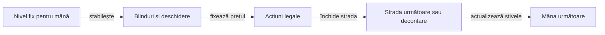
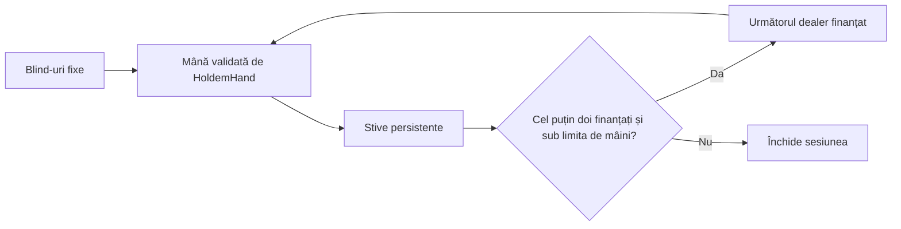

# Sesiuni Hold’em la o singură masă

[Profilul YAML de turneu](../../config/j6-tournaments.yaml) declară mesele de 4, 5 și 6 locuri, stiva inițială și nivelurile. `TournamentArena` gestionează timpul, eliminările și creșterea blind-urilor. `CashTableArena` oferă sesiuni fără turneu, cu stive persistente și blind-uri fixe. Ambele folosesc același motor de mână și aceleași reguli de plată.

## Reguli de turneu

| Moment | Regulă |
|---|---|
| Început de mână | Locurile cu zero jetoane sunt eliminate. Jucătorii păstrează locul fizic și butonul se deplasează printre locurile finanțate. |
| Alegerea nivelului | Indicele pornește de la zero. Adună numărul intervalelor complete de `levelSeconds` și eliminările cumulative, apoi se plafonează la ultimul nivel YAML. |
| Prag în timpul mâinii | Mâna păstrează nivelul cu care a început. La mâna următoare se aplică toate pragurile acumulate și eliminările nou confirmate. |
| Rămân doi jucători | Butonul postează small blind și joacă primul preflop. Celălalt loc joacă primul pe străzile următoare. Big blind-ul trece la următorul loc eligibil după big blind-ul anterior. |
| Rămâne un jucător | Turneul se încheie după decontare. Toate jetoanele mesei se află în stiva câștigătorului. |

## Cum se licitează



Toate sumele de acțiune sunt jetoanele pe care actorul le pune **acum**. Preflop, blindul mare stabilește prețul nominal și pasul inițial de raise. După flop, valoarea `minimumOpen` stabilește prima deschidere completă.

Un all-in sub pasul minim poate crește prețul fără să redeschidă singur raise-ul unui jucător care a acționat deja. Pentru acel jucător, creșterile cumulate ale prețului de la ultima acțiune trebuie să atingă mărimea ultimului raise complet. Pragul este evaluat la rândul lui; o creștere scurtă ulterioară nu anulează redeschiderea deja câștigată. La decontare, poturile se separă după contribuții și fiecare pot se acordă numai locurilor eligibile. Surplusul neacoperit se returnează, iar jetonul indivizibil merge la primul câștigător eligibil în sens orar după buton.

Un call folosește cel mult stiva rămasă. Când stiva nu ajunge pentru prețul curent, jucătorul rămâne eligibil doar pentru straturile acoperite de contribuția lui. Un jucător care a dat fold poate finanța un strat fără a fi eligibil să-l câștige.

Regulile de licitare, heads-up și împărțire au ca referință [Poker Tournament Directors Association](https://www.pokertda.com/view-poker-tda-rules/). Nivelurile, ritmul și creșterea la eliminare sunt convențiile laboratorului.

## Reproducere offline

După `mvn test`, rulați `ro.atf.holdem.arena.TournamentArena` cu directoarele `target/classes` din core, AI și arena și JAR-ul SnakeYAML din depozitul Maven. Argumentele sunt calea profilului YAML, calea nouă a jurnalului, numărul de turnee pentru fiecare mărime de masă, seed-ul inițial opțional, stilul candidat (`mixed`, `bluff`, `calling`, `loose`, `sized`, `pressure`, `equity`, variante `legacy-*` sau `control`) și calea opțională către YAML-ul unei variante de politică. CLI-ul simulează 12 secunde pe mână și păstrează aceiași adversari de referință: TAG, calling station și pressure. Cohorta `control` înlocuiește numai locul candidat cu TAG, păstrând seed-urile, nivelurile, adversarii și locurile.

Ambele cohorte citesc setările de frecvență și poziție din YAML-ul ales. `bluff` folosește trigger-ul postflop, `calling` verifică răspunsul pasiv, `pressure` aplică presiune minimă legală, iar `loose` folosește frecvențele și plafonul de call din `looseAggressive`. `mixed` rămâne alias pentru `bluff`. Rulează fiecare candidat și `control` cu același interval de seed; păstrează jurnalele separat, auditează fiecare și folosește `node scripts/compare-tournament-cohorts.cjs <candidat> <control>` pentru sumar. Comparația este de laborator cu varianță mare; procentul de victorii nu dovedește singur creșterea EV-ului.

Variantele de reglaj pentru loose-aggressive sunt declarate în `config/policy-tuning/`: conservatoare, echilibrată și agresivă. Într-o comparație se schimbă numai YAML-ul candidatului; seed-urile, profilul de turneu, pozițiile candidate și setul de adversari rămân aceleași.

CLI-ul acceptă un al șaptelea argument opțional `buttonOffset`. El rotește butonul inițial, păstrând neschimbat seed-ul generatorului de pachete. Acesta este un contrafactual de poziție pentru turneul complet: ordinea de amestec rămâne aceeași, iar rotația mută cărțile între locurile fizice. Candidatul și controlul trebuie să folosească același offset. `scripts/run-button-position-tournaments.ps1` poate selecta cohortele pressure, loose și sizing 50/100/150 pentru offseturile 0–5, în profilurile standard și stres; `scripts/audit-button-rotations.cjs` confirmă același flux de deal-uri și acoperirea fiecărui buton inițial.

Argumentul de stil poate selecta `mixed`, `bluff`, `calling`, `loose`, `sized`, `pressure`, `equity` sau `control`. Variantele `legacy`, `legacy-loose`, `legacy-pot` și `legacy-equity` reproduc cohorta veche pentru replay și ablații pereche; nu sunt profiluri de produs. YAML-ul politicii este încărcat indiferent dacă argumentele opționale includ sau nu offsetul de buton. Jurnalul fiecărei decizii păstrează poziția, strada, potul, suma de call și stiva observate înainte de acțiune, împreună cu versiunea completă a parametrilor policy.

`TournamentStrategyArena` folosește [configurația strictă de lineup](../../config/j6-strategy-lineups.yaml) pentru a plasa roluri AI diferite la aceeași masă și a roti atribuirea fiecărui rol prin locuri. Jurnalul `STRATEGY` leagă rolul de locul fizic pentru fiecare turneu. Jurnalul deciziei păstrează și blind-ul mare, locurile active, stivele și contribuțiile vizibile, locurile foldate, acțiunile all-in anterioare clasificate ca raise sau call, statisticile publice istorice și acțiunile legale. Nu include mâinile ascunse ori seed-ul dealerului în observația politicii.

`config/j6-strategy-lineups-shortstack.yaml` definește o cohortă adversarială pentru rolul `short-stack-shove`, cu prag maxim configurat de 8 big blind-uri. Politica împinge numai preflop cu perechi de nouari sau mai mari, A-T sau mai bine, ori K-Q; folosește all-in numai dacă acea acțiune exactă este legală, iar în celelalte stări revine la TAG. Este rol de testare a răspunsurilor, nu politică implicită a jocului și nu dovadă de EV. Testele unitare verifică atât trigger-ele, cât și fallback-ul; `TournamentStrategyArenaTest` verifică schema lineup-ului distinct pentru mesele de 4–6 locuri.

`scripts/run-strategy-rotation-tournaments.ps1` rulează pentru fiecare seed toate rotațiile rolurilor și pozițiilor inițiale ale butonului, atât în profilul standard, cât și în cel cu blind-uri accelerate. `-LineupFile config/j6-strategy-lineups-shortstack.yaml` selectează cohorta adversarială; `-SeatCounts`, `-ProfileNames` și `-SeedsPerSeatCount` îi restrâng matricea, iar `-Append` permite adăugarea fără suprascrierea urmelor existente. `-MavenRepository` indică explicit cache-ul extern care furnizează SnakeYAML. Pentru un snapshot extern fără `.git`, `-SourceCommit` fixează commitul complet de 40 de caractere, iar `-SourceDirty` marchează explicit o sursă cu modificări necomise. În interiorul aceluiași seed și offset de buton, atribuirea rolurilor se schimbă, dar fluxul de deal-uri rămâne identic. `audit-tournament.cjs` reconstruiește independent stack-urile, contribuțiile, poziția, call-ul, legalitatea, acțiunile all-in și settlement-ul. `summarize-strategy-rotation-tournaments.cjs` agregă traiectoria de stack și răspunsurile contextuale pe rol, poziție și seed. Rotațiile sunt măsurători repetate; ele nu trebuie raportate ca turnee statistice independente.

`equity` înlocuiește numai locurile candidate cu politica Monte Carlo în modul turneu; `control` păstrează TAG în aceleași locuri. `legacy-equity` face aceeași substituție în cadrul cohortelor legacy. Acțiunile candidate conțin bugetul și ponderile YAML folosite, iar `audit-tournament.cjs` validează jurnalele înainte de comparație.

`PublicOpponentTendency` înregistrează, pe loc fizic și în interiorul turneului, raise-urile all-in preflop care aveau o stivă rămasă `>2` și `<=10 BB` și o opțiune legală de raise. La all-in-ul curent se folosește suma acțiunii din istoricul public, nu stiva de la începutul mâinii după blind-uri. Contoarele se actualizează după terminarea mâinii; nu influențează o decizie anterioară din aceeași mână. Frecvența nu reprezintă un range de cărți: politica equity o folosește doar pentru ajustarea limitată la ±4 puncte a marjei de call când înfruntă un astfel de adversar. Priorul și sensibilitatea sunt configurabile în `equityDecision.contextWeights`, iar profilul equity baseline dezactivează sensibilitatea. `audit-tournament.cjs --require-public-shove-history` reconstruiește independent oportunitățile din acțiunile legale și verifică istoricul înaintea fiecărei decizii; testele nu validează EV ori strategie optimă.

Rotația butonului schimbă poziția inițială a fiecărui loc, dar păstrează fluxul de seed-uri al mâinilor. Pentru comparație, candidatul și controlul trebuie să folosească același seed, aceeași mărime de masă, același profil și același offset. Sumarul exclude offseturile care repetă poziții în mese mai mici. Numărul de expuneri pe poziție nu este automat un număr de turnee independente.

Metricile de fold după o acțiune agresivă sunt temporale: arată că fold-uri au urmat unei agresiuni în aceeași mână. Nu stabilesc ce bet a provocat fold-ul și nu măsoară singure fold equity sau EV. Pentru interpretare se citesc împreună cu mărimea relativă la pot, câștigurile fără showdown, evoluția stivei și rezultatele pe poziții.

### Rotația aceleiași distribuții

`PositionRotationExperiment` rulează aceleași cărți private pentru fiecare loc fizic, același board și același stack, apoi mută butonul prin toate cele șase poziții. Candidatele TAG, calling, pressure, loose, bluff și equity joacă numai pe `HoldemObservation`; varianta `bluff-always` este doar un control de accesibilitate al trigger-ului. Auditorul verifică legalitatea mutărilor și proiecția fiecărei decizii, apoi compară stiva finală cu TAG în același loc. Adversarii de control sunt calling stations, astfel încât limpurile și secvențele de check să poată fi observate fără informație ascunsă.

```powershell
$run = Join-Path 'C:\work\holdem_back' ('position-' + (Get-Date -Format 'yyyyMMdd-HHmmss'))
New-Item -ItemType Directory -Path $run | Out-Null
$cp = 'holdem-core\target\classes;holdem-ai\target\classes;holdem-arena\target\classes;C:\work\holdem_back\maven-cache\org\yaml\snakeyaml\2.2\snakeyaml-2.2.jar'
java -cp $cp ro.atf.holdem.arena.PositionRotationExperiment config/j6-policy.yaml "$run\positions.psv"
node scripts/audit-position-rotations.cjs "$run\positions.psv"
```

Auditul compară aceeași distribuție fizică între toate rotațiile, confirmă că actorul vede numai propriile cărți și board-ul ajuns până la strada curentă și verifică acțiunea în meniul legal. Aceste mâini controlate validează mecanisme și sensibilitatea la poziție; nu estimează singure forța unui stil în turneu.

Exemplu PowerShell, din rădăcina proiectului (JAR-ul SnakeYAML trebuie să existe în repository-ul Maven local):

```powershell
$run = 'C:\work\holdem_back\j6-run'
$cp = 'holdem-core\target\classes;holdem-ai\target\classes;holdem-arena\target\classes;C:\work\holdem_back\maven-cache\org\yaml\snakeyaml\2.2\snakeyaml-2.2.jar'
New-Item -ItemType Directory -Force -Path $run | Out-Null
java -cp $cp ro.atf.holdem.arena.TournamentArena config/j6-tournaments-stress.yaml "$run\mixed.trace" 50 7000 mixed
java -cp $cp ro.atf.holdem.arena.TournamentArena config/j6-tournaments-stress.yaml "$run\control.trace" 50 7000 control
node scripts/audit-tournament.cjs "$run\mixed.trace" --require-layers
node scripts/audit-tournament.cjs "$run\control.trace" --require-layers
node scripts/compare-tournament-cohorts.cjs "$run\mixed.trace" "$run\control.trace"
```

Pentru fixture-ul de redeschidere, adaugă `-Dj6.challenge.trace=<cale-nouă>` la `mvn test`, apoi rulează auditorul de provocări pe jurnalul rezultat.

Jurnalul local păstrează seed-ul, nivelul, acțiunile, board-ul public, plățile și stivele. Politicile primesc doar observația actorului.

| Eveniment | Ce permite verificarea |
|---|---|
| `POT` | Pragul cumulativ al contribuției pe loc, totalul stratului, locurile eligibile și câștigătorii în ordinea folosită pentru jetoanele indivizibile. |
| `RETURN` | Locul și surplusul neacoperit returnat separat de poturi. |
| `SHOWDOWN` sau `FOLD_WIN` | Totalul virat fiecărui loc, inclusiv surplusul returnat, înainte de stivele finale. |

Rulați `node scripts/audit-tournament.cjs <jurnal> --require-layers` pentru un jurnal nou. Verificatorul reface distribuirea JDK 21 din seed, ordinea acțiunilor, sumele, dreptul de raise și clasarea mâinilor independent de motorul Java. Pentru jurnalele vechi, omiteți opțiunea pentru a verifica decontarea agregată.

[Profilul de stres](../../config/j6-tournaments-stress.yaml) reduce stiva și durata nivelului și ridică deschiderea postflop peste blindul mare. Rulați-l separat de profilul standard pentru a exercita call-uri parțiale și poturi secundare mai devreme în turneu.

## Provocări de decontare și redeschidere

[Setul YAML de provocări](../../config/j6-allin-challenges.yaml) descrie stări de masă deterministe, nu rezultate injectate în turneu. Testul din `holdem-arena` construiește mâna prin motorul real, verifică actorul și meniul legal înaintea fiecărei acțiuni, apoi compară straturile de pot, eligibilitatea, câștigătorii, ordinea jetoanelor impare și conservarea stivei. Distribuirea specifică de șase locuri exercită patru all-in-uri scurte, o redeschidere cumulată, patru straturi împărțite la egalitate și straturi laterale cu resturi impare. Jurnalele acestor provocări pot fi exportate prin proprietatea Maven `j6.challenge.trace` și verificate separat cu `node scripts/audit-allin-challenge.cjs <jurnal>`.

Provocările testează fragmente precise de reguli. Cohortele CLI rămân turnee complete, cu niveluri, eliminări și politici mixte; rezultatul cohortelor nu înlocuiește verificarea deterministă a unei reguli.

## Sesiune cash fără turneu

O sesiune cash păstrează stiva de la o mână la următoarea și folosește aceeași structură de blind-uri la fiecare mână. Nu există ceas de nivel, creștere după timp sau eliminare turneistică; locurile cu stivă zero nu mai intră în mâinile următoare, iar sesiunea se încheie la limita configurată sau când rămâne un singur loc finanțat. Arena acceptă 2–6 locuri, stack-uri inițiale și un seed reproductibil. Jurnalul păstrează pentru fiecare mână dealerul, blind-urile, seed-ul de deal și stivele după plată.



Rulați comparația pereche din rădăcina proiectului după ce `mvn test` a compilat modulele:

```powershell
$run = Join-Path 'C:\work\holdem_back' ('cash-' + (Get-Date -Format 'yyyyMMdd-HHmmss'))
.\scripts\run-cash-sessions.ps1 -OutputRoot $run -FirstSeed 12000 -SessionsPerSeatCount 8 -HandLimit 100
```

Scriptul compară Equity Monte Carlo cu controlul pe aceleași seed-uri și primul buton, pentru mese de 4–6 locuri și offseturi repetate. Jurnalele se auditează separat; dealerul ulterior poate diferi dacă strategiile ajung la stive diferite și elimină locuri diferite. Sumarul arată cota finală a stivei pentru locurile candidate, nu profit așteptat; nu include rake și nu califică o politică drept câștigătoare.
